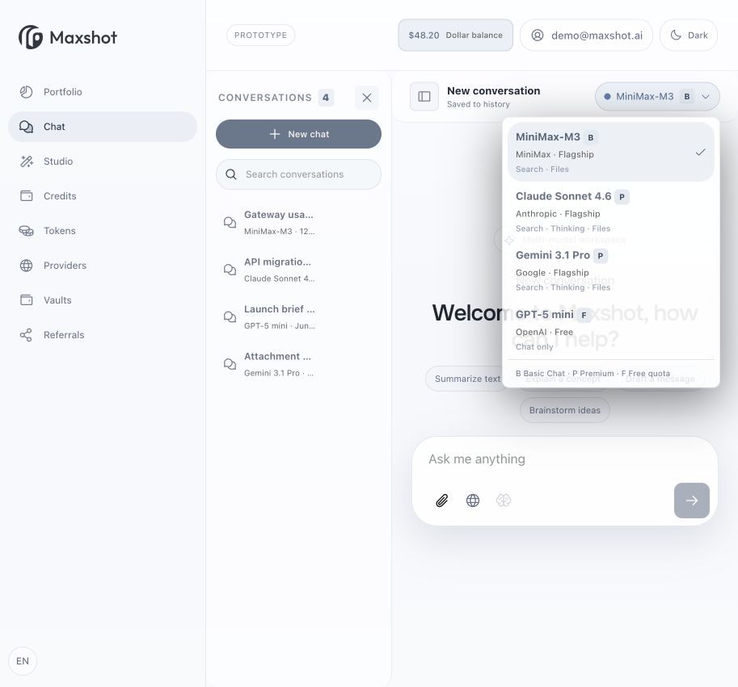
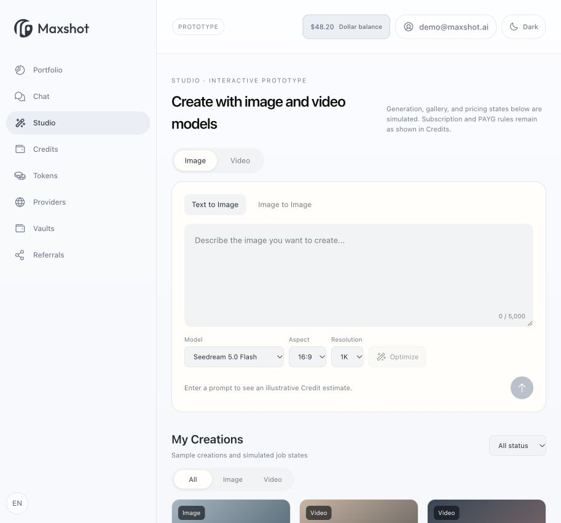
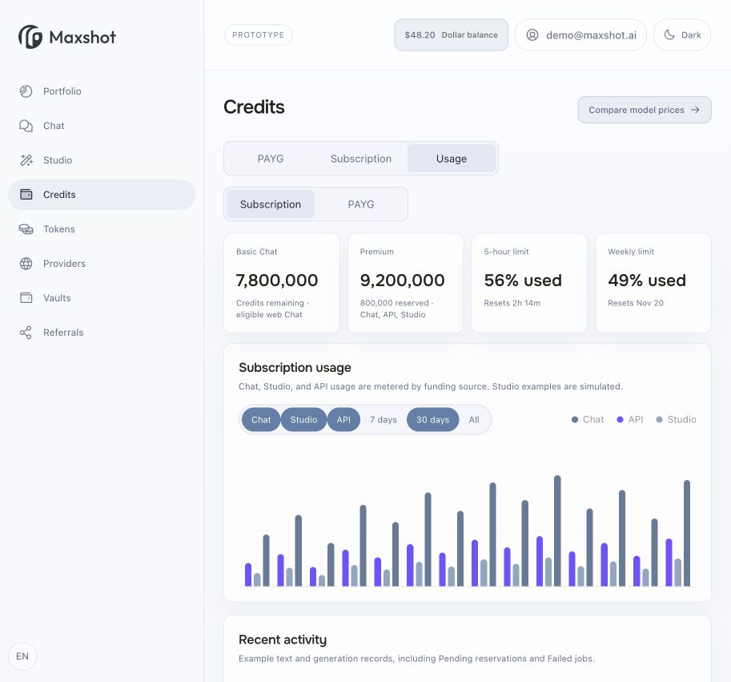
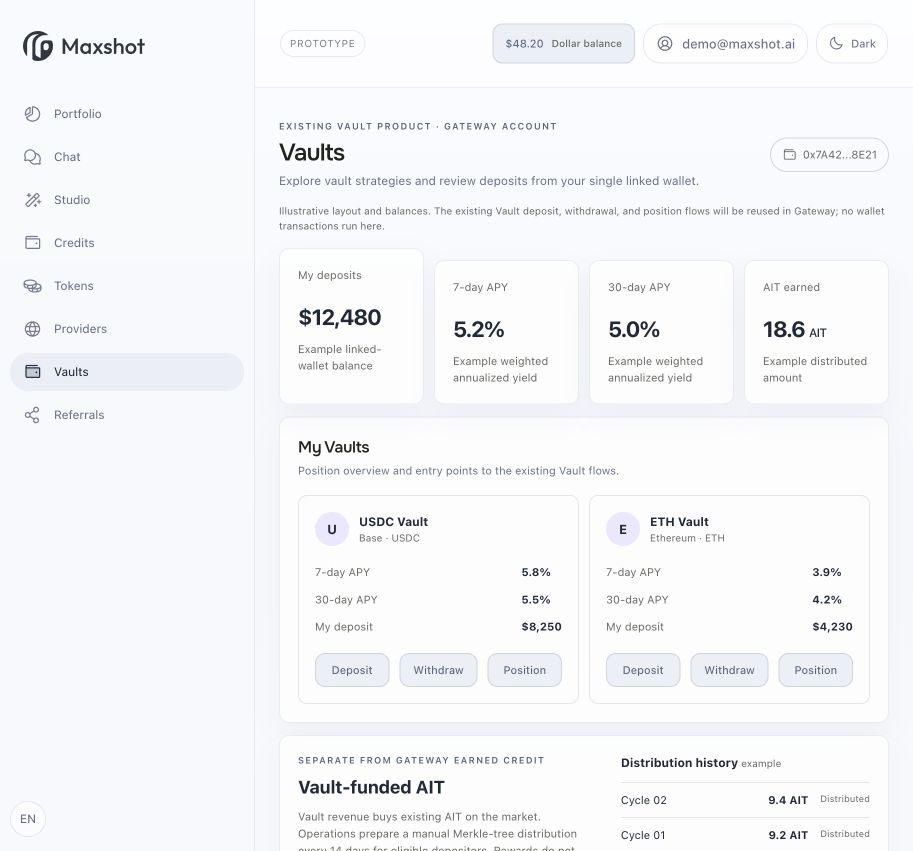
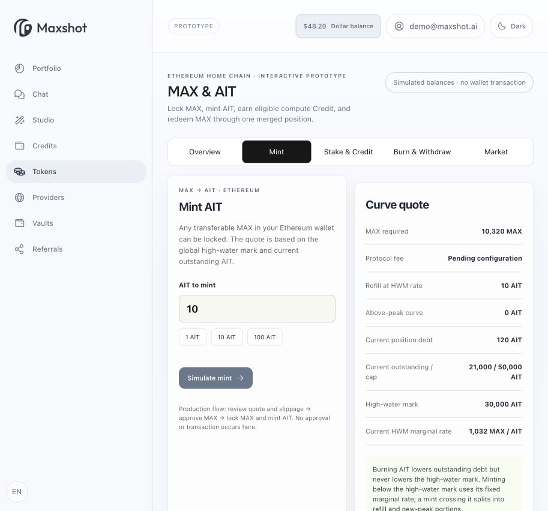
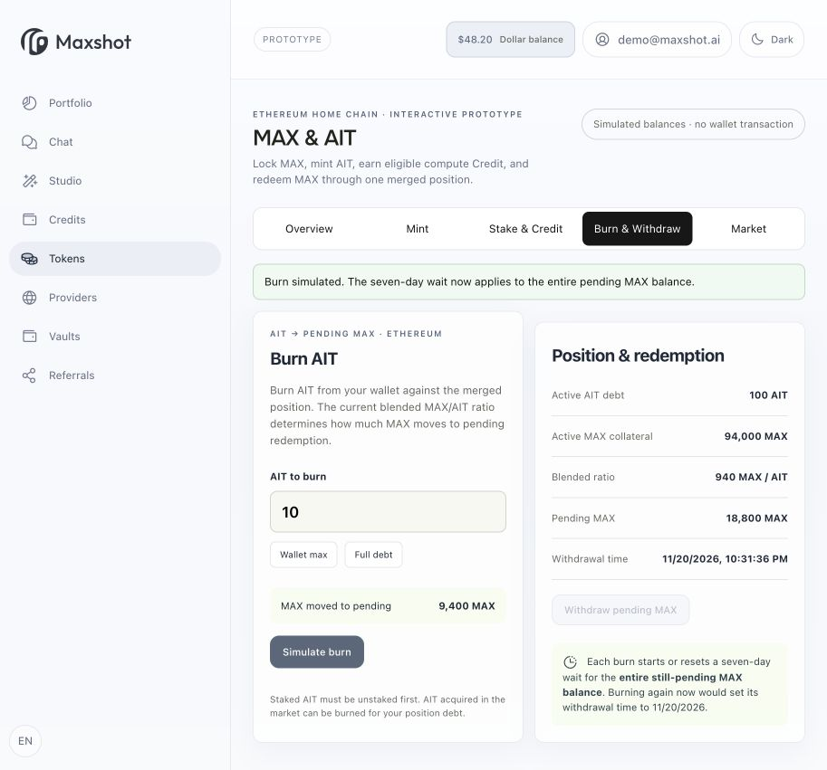

# Maxshot requirements, design, and prototype audit

**Audit date:** 13 November 2026 (Toronto)
**Scope:** Unified Gateway launch direction, subscription, provider catalog/routing, MAX/AIT, Vaults, referrals, and the local React prototype. The read-only token source PRD was inspected, not edited. This is an audit of product handoff readiness, not production system verification.

## Verdict against this round's goals

| Goal | Verdict | Reason |
| --- | --- | --- |
| 1. Requirements clear and concise | **Met for development handoff** | The [handoff index](./DEVELOPMENT_HANDOFF_INDEX.md) assigns document authority, and the [release matrix](./RELEASE_SCOPE_MATRIX.md) separates launch journeys from later scope. The read-only token source remains background where superseded by confirmed decisions. |
| 2. Design structured and ready for handoff | **Met for development handoff** | The confirmed token arithmetic and B1–B5 handoffs define catalog, authorization/settlement, Vault migration, provider admission/routing, and token/wallet/Credit acceptance. Live integration and release inputs still require implementation evidence. |
| 3. Prototype aligns with requirements and design | **Met as a labeled simulation** | Navigation, common sample model eligibility, pre-submit quote, Usage trace, wallet-only Vault exit and referral units follow the approved rules. No simulated action proves a live contract, provider call or ledger posting. |

**Handoff call (updated 15 November 2026):** H1–H3 and H9 are resolved for product requirements. H4 is a development suggestion, not a product blocker. H5–H8 are resolved in the prototype. [B1](./PROVIDERS_FRONTEND_DATA_CONTRACT.md#b1-catalog-acceptance-matrix), [B2](./REQUEST_AUTHORIZATION_SETTLEMENT_HANDOFF.md), [B3](./VAULT_ACCOUNT_MIGRATION_HANDOFF.md), [B4](./PROVIDER_ADMISSION_ROUTING_HANDOFF.md) and [B5](./TOKEN_WALLET_CREDIT_HANDOFF.md) now have development acceptance criteria; none has been verified against production in this checkout. Commercial economics, legal approval, numeric operational thresholds, and deployment configuration remain separate release inputs.

## What is sound

- The [decision addendum](./MAXSHOT_Decision_Gaps_and_Handoff_Addendum.md) clearly supersedes the read-only token source for merged positions, HWM refill, proportional burn, seven-day pending redemption, MAX/AIT precision, supply, and chain scope. Its integer mint formula and vectors are unusually concrete for product handoff. The current prototype's [first burn](./audit-2026-11-13-round2/17-burn-pending.jpg) moved 9,400 MAX to pending, and a [second burn](./audit-2026-11-13-round2/18-burn-reset.jpg) increased pending MAX to 18,800 and reset the shared withdrawal timestamp.
- [Provider admission](./PROVIDER_INTEGRATION_MINIMUM_STANDARD.md) is intentionally minimal: per-offering rights, authenticated connection, verified identity/capabilities/rates, a scripted test, metering, and disable control. A second route is needed once to prove shared routing, not for every model.
- The [routing design](./MULTI_PROVIDER_ROUTING_DESIGN.md) separates customer model selection from provider selection and limits fallback to one equivalent offering before output. The [frontend data contract](./PROVIDERS_FRONTEND_DATA_CONTRACT.md) defines stable IDs, rate versions, and per-offering evidence.
- The [unified-app decision](./MAXSHOT_Unified_Gateway_App_Decisions.md) assigns Portfolio, Vaults, MAX/AIT, Credits, and the two referral programs coherent roles. Captured [Portfolio](./audit-2026-11-13-round2/02-portfolio.jpg), [Tokens](./audit-2026-11-13-round2/08-tokens.jpg), [Vaults](./audit-2026-11-13-round2/09-vaults.jpg), and [Referrals](./audit-2026-11-13-round2/10-referrals.jpg) broadly follow that information architecture.

## Findings, in handoff order

### H1 — Conflicting document authority and stale normative requirements **[P0, documentation]**

**Resolution recorded 15 November 2026:** [Development handoff index](./DEVELOPMENT_HANDOFF_INDEX.md) assigns ownership by subject and identifies the older unified-app and pricing clauses it supersedes. The read-only token source was not changed. Earlier Gateway, Studio, and baseline documents must be read through that index for this handoff.

The [Gateway PRD](../MAXSHOT_GATEWAY_PRD.md#L19) calls itself the single source of truth and binds product design to the older baseline. Its [navigation](../MAXSHOT_GATEWAY_PRD.md#L426) still specifies Chat, Dashboard, API, Credits, Referral, Profile, plus visible experimental Agents/Toolkits. The [Studio PRD](../MAXSHOT_STUDIO_PRD.md#L17) calls itself Studio's source of truth and still requires a shell Pricing entry [between Credits and Referral](../MAXSHOT_STUDIO_PRD.md#L450), while the later confirmed [unified navigation](../frontend/TOKEN_UI_REFERENCE_MAP.md#L7) puts Models & Pricing inside Providers and moves API under Profile. The token [addendum precedence](./MAXSHOT_Decision_Gaps_and_Handoff_Addendum.md#L8) explicitly covers only the read-only token PRD, not these two PRDs.

**Effect:** A Gateway or Studio team following its own authoritative PRD can implement the wrong navigation or pricing surface while believing it is compliant. **Close:** publish one short, versioned launch-scope and precedence table covering Gateway, Studio, subscription, unified app, and token addendum. Mark superseded clauses/sections in the mutable Gateway and Studio PRDs, while preserving the read-only token source. Avoid duplicating full requirements across files.

### H2 — Launch slice and phase ownership are not explicit enough **[P0, requirements]**

**Resolution recorded 15 November 2026:** The [release scope matrix](./RELEASE_SCOPE_MATRIX.md) separates the agreed agent-style integration path for external agents from a managed Agent product. The founder clarified that “one Agent per account at launch” is **not** a confirmed Tokenomics-release must-have. Addendum TD-24 and companion token documents now reflect that boundary. Gateway/subscription foundation, unified MAX/AIT migration, and later features have explicit journey ownership. The prototype now describes the shared account ledger without a managed-Agent count.

The [feature requirements](./MAXSHOT_Feature_Requirements_PRD.md#L103) put Agent guide/wallet and referrals in “later phases,” yet the same table says [one Agent per account at launch](./MAXSHOT_Feature_Requirements_PRD.md#L107). The [unified-app decision](./MAXSHOT_Unified_Gateway_App_Decisions.md#L19) and captured [Referrals](./audit-2026-11-13-round2/10-referrals.jpg) retain two visible referral programs. The source token PRD also carries older Agent Wallet and growth scope. “One Agent allowed” could mean a usable launch integration or merely a limit if an Agent feature ships later.

**Effect:** Teams cannot tell which user journeys must pass in the subscription release, token release, or later growth release. **Close:** one release matrix with each journey marked **required, visible simulated, existing flow to migrate, or deferred**. Include Agent setup/skill, Maxshot referrals, Partner referrals, Vault AIT claims, Provider Tokens, Auto routing, and Studio sharing. Record whether the one-Agent rule implies a launch UI/API deliverable.

### H3 — Customer authorization maximum and media shortfall language diverge **[P0, billing design]**

**Resolution recorded 15 November 2026:** Addendum TD-39 and the subscription, Studio, baseline, routing and provider documents now require a server estimate plus hard maximum for text and media. The full maximum is reserved before dispatch, including any permitted same-model fallback rate. Final customer charge may exceed the estimate but never that maximum; unused holds return to their source and expiry, and provider overrun is a separate platform/provider discrepancy. The prototype quote and Usage examples remain for the later alignment pass.

The later [token/routing decision](./MAXSHOT_Decision_Gaps_and_Handoff_Addendum.md#L149) requires a disclosed authorized maximum that covers allowed fallback, and the [frontend contract](./PROVIDERS_FRONTEND_DATA_CONTRACT.md#L115) requires the server to reserve that maximum before dispatch. The [subscription charging algorithm](../SUBSCRIPTION_FEATURE_REQUIREMENTS.md#L203) instead says media reserves an **estimate** and may collect an “authorized shortfall”; it also defers a fixed customer-facing Credit quote. Those statements can coexist only if “estimate,” “maximum,” and any additional authorization have distinct definitions. They do not currently.

**Effect:** A media job or fallback could exceed the original authorization, or implementations could reject valid jobs differently. **Close:** require an estimate and hard maximum, reserve the maximum by funding source before dispatch, and cap the final customer charge at that maximum. Provider overrun is a separate discrepancy. Test mixed Earned/subscription/Paid funding, pending jobs across renewal, fallback at a different customer rate, cancellation, and refunds. The internal record shape is an engineering choice.

### H4 — Common request identity and trace **[development suggestion; not a product blocker]**

**Reclassified 15 November 2026:** The founder confirmed that a single request record and its exact fields are implementation choices. The product requirements are the already agreed outcomes across Chat, Studio, API, routing, billing, and Usage: consistent catalog eligibility; the applicable estimate and hard maximum; authorized same-model fallback; one customer settlement; and a Usage detail that explains the serving offering, rate, verified units, funding, and final charge. Engineering may use any internal schema or service boundary that delivers and verifies those outcomes.

The [provider frontend contract](./PROVIDERS_FRONTEND_DATA_CONTRACT.md#L13) is deliberately a **read snapshot**, and its backend checklist [defers mapping](./PROVIDERS_FRONTEND_DATA_CONTRACT.md#L120) to the production Gateway. The [routing design](./MULTI_PROVIDER_ROUTING_DESIGN.md#L86) lists trace fields, but no one handoff artifact connects catalog eligibility, Chat/Studio quote, API single-call authorization, streaming/media completion, Usage, billing ledger, and explicit provider pin. The UI currently has a [Chat picker](./audit-2026-11-13-round2/04-chat-model-picker.jpg), [Studio picker](./audit-2026-11-13-round2/05-studio.jpg), and [API log](./audit-2026-11-13-round2/13-developer-settings.jpg), but no common request identity shown across them.

**Development suggestion:** Trace **catalog read → quote/authorize → dispatch/one fallback → settle/refund → Usage detail** through a common request identity. A request/attempt field table covering model and offering identity, accepted versions, maximum, funding, verified units, and pin/fallback decisions may simplify implementation and support. Endpoint names, internal IDs, record boundaries, and storage remain engineering-owned; no additional product approval is needed for an equivalent implementation.

### H5 — Prototype model lists and availability are inconsistent **[P1, prototype alignment]**

**Resolution updated 15 November 2026:** TD-41 supersedes the earlier disabled-choice treatment and now sets a minimum of **five distinct usable models** in each enabled text, image, and video catalog. The prototype derives picker entries from the same simulated `providerSnapshot` used by Providers and omits unavailable models. Its five sample choices per catalog use illustrative offerings and prices, not evidence of live provider verification. Historical conversations and creations remain viewable; trying a removed model switches to a usable model with notice.

Providers/Models & Pricing use a versioned-looking simulated [`providerSnapshot`](../frontend/src/data/providerCatalog.js), while [Chat](../frontend/src/data/chatData.js#L85) and [Studio](../frontend/src/pages/StudioPage.jsx#L11) use independent static lists. The captured [Studio picker](./audit-2026-11-13-round2/05-studio.jpg) defaults to Seedream 5.0 Flash, which the captured [provider catalog](./audit-2026-11-13-round2/11-providers-profiles.jpg) labels admission pending. The captured [Video pricing list](./audit-2026-11-13-round2/01-providers-pricing.jpg) has only admission-pending examples, yet Studio offers video models. The [read contract](./PROVIDERS_FRONTEND_DATA_CONTRACT.md#L114) requires picker availability derived from admitted offerings.

**Effect:** A prototype viewer can infer that a generation route is ready when the provider evidence says it is not. **Close:** after the shared catalog contract is agreed, bind all prototype pickers to the same fixture or explicitly mark picker options as separate unverified examples. Production pickers must list only available, eligible routes.

### H6 — Quote and Usage states do not demonstrate the agreed billing behavior **[P1, prototype alignment]**

**Resolution recorded 15 November 2026:** An approved, explicitly simulated Chat quote shows selected offering/rate, estimate, hard maximum, bounded sample units, and maximum reservation by hypothetical Earned and Premium buckets. Completing a mock Claude request creates a matching Credits → Usage detail: the selected OpenRouter offering, Provider B serving offering after a simulated pre-output failure, verified units, actual serving rate, 1,335-Credit final charge against a 1,500-Credit maximum, and 165 Credits released to Premium. Studio shows a corresponding pre-submit quote for the available FLUX 3 Image route. The 100,000 Credits/$1 conversion is an illustrative prototype fixture, not a funded-term input; no real provider call or account debit occurs. Browser interaction verified the journey. Production backend and API integration remain unverified.

The captured [Chat](./audit-2026-11-13-round2/03-chat.jpg) and [Studio](./audit-2026-11-13-round2/05-studio.jpg) starting states have no selected offering, rate version, funding split, or maximum. [Usage](./audit-2026-11-13-round2/07-usage.jpg) shows a serving-provider name and funding label, but no request detail with selected versus serving offering, accepted rate version, fallback, verified units by billable component, or reversal. The [API log](./audit-2026-11-13-round2/13-developer-settings.jpg) only lists requested model and aggregate charge. This is already listed as an integration gap in the [prior audit](./DEVELOPMENT_READINESS_AUDIT_2026-11-13.md).

**Effect:** The prototype illustrates pages but cannot serve as an acceptance example for end-to-end authorization and settlement. **Close:** add one representative request path and one fallback/refund record only when the shared contract is fixed; keep all values visibly simulated.

### H7 — Wallet-only Vault exit is decided but hidden behind Gateway login **[P1, prototype alignment]**

**Resolution recorded 15 November 2026:** Vaults is accessible while logged out. The prototype shows a simulated position-wallet connection, existing positions, and a withdrawal entry without account linking. Portfolio remains login-gated. The actual Vault contract transaction is intentionally represented by the existing-flow entry, not reimplemented in the prototype.

The [unified decision](./MAXSHOT_Unified_Gateway_App_Decisions.md#L11) and [feature acceptance](./MAXSHOT_Feature_Requirements_PRD.md#L66) explicitly allow an existing depositor to withdraw with the position wallet before linking an account. At audit time, the prototype blocked `vaults` for logged-out users; the captured [Vaults screen](./audit-2026-11-13-round2/09-vaults.jpg) was only an authenticated, simulated overview.

**Effect:** The prototype cannot demonstrate a critical migration safety rule. **Close:** represent a wallet-only exit entry state and account-link boundary in the handoff flow; retain the original Vault deposit/withdraw transaction implementation instead of inventing new economics or rebuilding the detailed screens.

### H8 — Referral prototype carries the old top-up unit **[P1, terminology/accounting]**

**Resolution recorded 15 November 2026:** Founder-approved TD-42 uses the confirmed referred top-up event and the USD amount credited to Dollar balance after fees. The prototype displays that volume in USD and illustrative promotional rewards in separate Credits at a labeled sample conversion. Subscription payments are excluded; final rate and cap remain commercial inputs.

The captured [Maxshot referral page](./audit-2026-11-13-round2/10-referrals.jpg) calls referred top-ups and their measured volume **Credits**. The [Gateway PRD](../MAXSHOT_GATEWAY_PRD.md#L461) and [subscription requirements](../SUBSCRIPTION_FEATURE_REQUIREMENTS.md#L73) separate user-funded **Dollar balance** from usage/promotional **Credits**. The 1% reward is correctly labeled illustrative, but the basis of a top-up cannot be both units without an explicit conversion and event definition.

**Effect:** Referral attribution and reward accounting could key off the wrong ledger event. **Close:** specify whether referral qualification uses settled Dollar deposits, consumed paid inference, or another approved event; then use the same unit and conversion in the visible example. Final percentage remains a commercial decision.

### H9 — Earned Credit grant precision has no executable rule **[P0, ledger design]**

**Resolution recorded 15 November 2026:** Founder-approved TD-40 locks a versioned Credit conversion rate per funded term and uses cumulative integer entitlement from finalized AIT-wei-seconds. Each shared seven-day grant, including the final short interval, issues the floored cumulative amount minus prior grants. Fractions carry across epochs and unstaking; the final sub-Credit remainder is discarded. The addendum supplies formula and boundary vectors. This closes the product arithmetic decision; the actual term conversion value remains a funded-program input.

The [feature requirements](./MAXSHOT_Feature_Requirements_PRD.md#L94) promise `$12/365` USD-credit per AIT-day and immediate time-weighted accrual; the [decision addendum](./MAXSHOT_Decision_Gaps_and_Handoff_Addendum.md#L143) fixes seven-day batches and final short intervals. The [subscription ledger](../SUBSCRIPTION_FEATURE_REQUIREMENTS.md#L273) stores integer Credits and microdollars and requires a conversion rounding policy to be retained, but neither handoff defines how fractional AIT-seconds become integer Earned Credits, whether sub-Credit remainders carry between epochs, or how to test that splitting a stake cannot increase the total grant.

**Effect:** Two valid-looking implementations can issue different grants for the same staking history. **Close:** specify the fixed-point accrual unit, exact grant-rounding point, remainder treatment across seven-day intervals and unstake, and 2–3 boundary vectors (mid-epoch stake/unstake, final short epoch, tiny stake). This is an arithmetic handoff rule; it does not require the marketing team to set a new economic rate.

## Current prototype walkthrough and evidence

All captures below were taken in this audit run at a 913 × 851 desktop viewport. Each file was opened and visually inspected after capture. “Healthy” means the represented layout/ownership is coherent; it does **not** mean live integration has been verified.

| Step | Screen | Health | Observation |
| --- | --- | --- | --- |
| 1 | [Providers → Models & Pricing](./audit-2026-11-13-round2/01-providers-pricing.jpg) | Partial | Provider-specific rates and pending labels; video has no admitted example. |
| 2 | [Portfolio](./audit-2026-11-13-round2/02-portfolio.jpg) | Healthy as summary | One account, wallet, Vault, MAX/AIT, Credits sections. |
| 3 | [Chat](./audit-2026-11-13-round2/03-chat.jpg) | Partial | Manual model selection; no quote state in initial view. |
| 4 | [Chat model picker](./audit-2026-11-13-round2/04-chat-model-picker.jpg) | Partial | Separate list/eligibility tags; dropdown transparency reduces legibility at this width. |
| 5 | [Studio](./audit-2026-11-13-round2/05-studio.jpg) | Partial | Media creation shape is present; default sample model is pending in provider catalog. |
| 6 | [Credits → Subscription](./audit-2026-11-13-round2/06-credits.jpg) | Partial | Distinct subscription buckets and Earned-first copy; no detailed Earned grant list. |
| 7 | [Credits → Usage](./audit-2026-11-13-round2/07-usage.jpg) | Partial | Funding-source overview, but no accepted/serving offering and quote trace. |
| 8 | [Tokens overview](./audit-2026-11-13-round2/08-tokens.jpg) | Healthy as simulation | Merged position, pending MAX, staking entry points, clear prototype label. |
| 9 | [Vaults](./audit-2026-11-13-round2/09-vaults.jpg) | Partial | Summary and existing-flow entry points; wallet-only exit state absent. |
| 10 | [Referrals](./audit-2026-11-13-round2/10-referrals.jpg) | Partial | Two-program structure; Gateway top-up unit is inconsistent. |
| 11 | [Provider profiles](./audit-2026-11-13-round2/11-providers-profiles.jpg) | Healthy as simulation | Per-offering status, capabilities, policy, and observed metrics. |
| 12 | [Account menu](./audit-2026-11-13-round2/12-account-menu.jpg) | Healthy | API is reachable under Developer settings. |
| 13 | [Developer settings](./audit-2026-11-13-round2/13-developer-settings.jpg) | Partial | Keys and request log exist; route/rate/fallback detail is absent. |
| 14 | [MAX/AIT Mint](./audit-2026-11-13-round2/14-mint.jpg) | Healthy as simulation | HWM, refill, cap, and quote are visible; browser math is illustrative. |
| 15 | [AIT Stake & Credit](./audit-2026-11-13-round2/15-stake.jpg) | Healthy as simulation | No warm-up/lock; program is labeled draft and unfunded. |
| 16 | [Burn & Withdraw](./audit-2026-11-13-round2/16-burn-withdraw.jpg) | Healthy as simulation | Blended ratio and pending-redemption rule are visible. |
| 17 | [After first burn](./audit-2026-11-13-round2/17-burn-pending.jpg) | Healthy as simulation | 10 AIT debt burned; 9,400 MAX moved to pending for seven days. |
| 18 | [After second burn](./audit-2026-11-13-round2/18-burn-reset.jpg) | Healthy as simulation | Another 10 AIT burned; all 18,800 pending MAX received the later common withdrawal timestamp. |

### Key captured screens

## Recommended closure sequence

1. **Normalize document authority and launch scope (H1–H2).** Deliver one page of precedence and a journey-by-release matrix. Verify every retained screen and deferred feature has one owner and status.
2. **Implement the agreed arithmetic and request outcomes.** Apply TD-40's Earned grant rounding. Engineering can document its chosen request trace and verify two end-to-end examples: an ordinary mixed-bucket call and same-model fallback with a different rate. Both must settle once and show a complete Usage record.
3. **Reconcile the remaining prototype gap (H8; completed 15 November 2026).** Specify and show consistent referral units. Verify against the written matrix and contract.

## Limits

This audit used local documents, frontend source, and current desktop prototype screenshots. It did not inspect the production Gateway backend, current live app routes, connected wallets, real Vault transactions, on-chain contracts, LayerZero messages, provider accounts, payment rails, mobile breakpoints, keyboard-only use, screen readers, or color-contrast measurements. The dropdown legibility observation is visual; accessibility compliance remains unverified. Operational/marketing inputs excluded by the founder are not reclassified as development decisions here.
