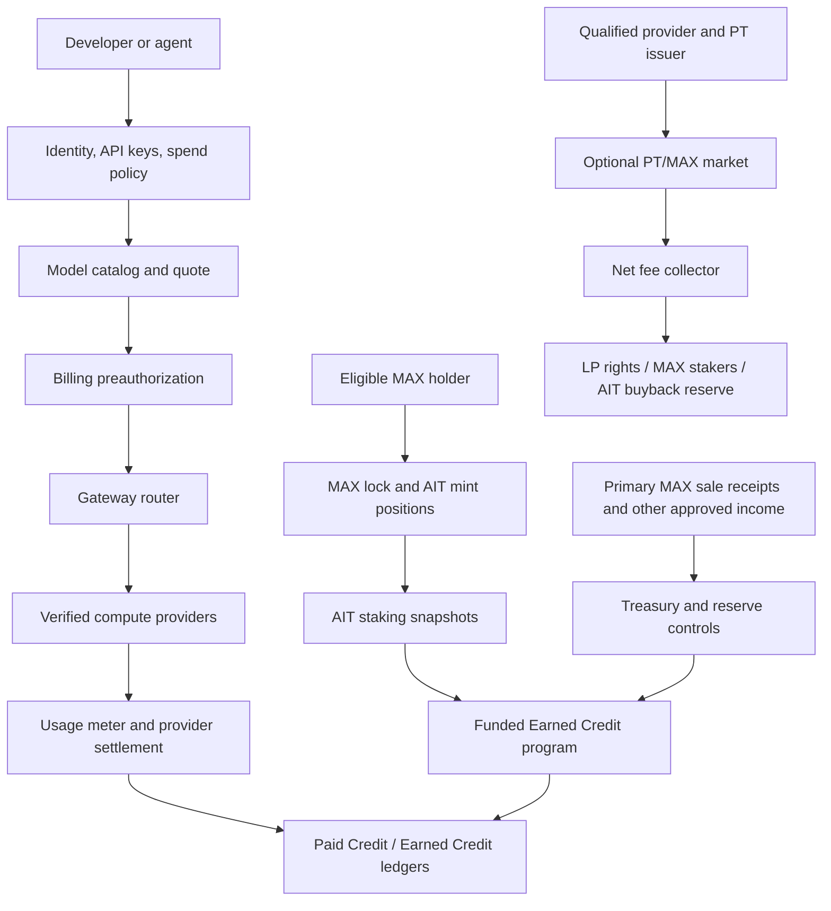

# Maxshot — High-Level Feature Requirements

**Status:** Working product specification, derived from `MAXSHOT_Tokens_PRD_v1.0(read only).md` (2026-11-11). Proposed economics and release gates are not approved launch terms.  
**Scope:** Gateway, compute supply, MAX/AIT, optional provider tokens, agent distribution, finance and controls.

**Founder decision update (2026-11-11):** One merged mint position per controller with the same terms; no position time lock. AIT burns move proportional MAX to a pending redemption balance. The entire pending balance becomes withdrawable seven days after the latest burn. HWM refill uses the exact two-part quote in §4.2. MAX and AIT each use 18 decimals. These decisions update the working design but do not waive launch gates.

**Development-round addendum:** `MAXSHOT_Decision_Gaps_and_Handoff_Addendum.md` records later founder decisions where this document or the read-only source differs. It is the working override for those listed decisions.

## 1. Product definition

Maxshot is an agent-native AI inference network with three connected layers:

1. **Compute:** a model-first LLM Gateway that routes paid requests to verified providers, meters usage, and settles providers.
2. **Distribution:** developer and agent onboarding, controlled agent wallets, share links and funded referral programs.
3. **Economics:** MAX capital formation and locking, AIT issuance and funded compute allowances, plus a later qualified provider-token market.

The basic Gateway works with normal payment; MAX, AIT and provider tokens are optional for inference customers. Inference routing and billing run off-chain. Contracts record token state and enforce economic rules.

At launch, Ethereum is the home chain for MAX/AIT mint positions and AIT staking. MAX moves by LayerZero between Ethereum, Base, Arbitrum One and Robinhood Chain, including direct routes between those chains. AIT remains on Ethereum at launch; its LayerZero capability is reserved for later activation.

## 2. System framework

**Accounting boundary:** only actual primary-sale receipts add initial Treasury capital. MAX locks, secondary token purchases and token FDV do not. Paid inference margin and PT trading fees are separate cash flows.

## 3. Users and primary journeys

| User | Job | Core journey |
|---|---|---|
| Developer | Call a model at a known price | Select model → fund account → scoped key → call → inspect usage and charge |
| Agent builder | Connect an existing agent safely | Read verified setup guide → scoped key → budget/model limits → test call |
| Compute provider | Sell real inference capacity | Apply → rights/technical review → benchmark → limited routing → settlement |
| MAX holder | Mint AIT using eligible MAX | Inspect quote and risks → lock MAX → record position and AIT debt |
| AIT holder | Receive usable compute allowance | Stake AIT in an active funded term → accrue/grant → spend before expiry |
| Position controller | Recover locked MAX | Obtain owed AIT → burn against merged position → wait seven days after latest burn → withdraw pending MAX |
| Qualified PT participant | Trade a provider-specific instrument | Review legally defined rights/eligibility → trade where permitted |
| Finance/risk operator | Maintain solvency | Reconcile receipts, liquid reserves, credit exposure and provider payables |

## 4. Feature requirements and acceptance

### 4.1 Gateway and accounts — compute-first MVP

| Feature | Requirement | Acceptance evidence |
|---|---|---|
| Identity and keys | Secure sign-in, scoped API keys, revocation, account and agent spending limits | Revoked keys fail; over-budget requests stop before provider invocation |
| Model-first catalog | Dynamic list of all verified models from supported launch providers; shared customer model ID only for verified same version/capabilities; current model-catalog assignment | Each listed model completes a live smoke test at displayed price; mismatched versions have separate IDs |
| Inference API | Advertised streaming, structured output and tool behavior per enabled model | Contract tests for every advertised capability |
| Router and provider adapters | For the selected model, choose the lowest quoted-cost verified provider meeting capability, quality, latency and data-policy constraints; fallback only within authorized maximum cost | Route and fallback traces show chosen provider, constraints and capped cost |
| Usage and billing | Use existing crypto deposits for Paid Credit after verifying the live flow; request-level metering, idempotent preauthorization/settlement and separate Paid/Earned balances; eligible Earned Credit usable through UI and the account's single scoped Agent | Deposit-to-balance and customer/provider ledgers reconcile; agent model/spend limits hold |
| Provider operations | Legal/supply verification, benchmark, staged traffic, payout and dispute ledger | Qualified provider produces a verified paid call and reconciled settlement |

### 4.2 MAX and AIT — gated Genesis

| Feature | Requirement | Acceptance evidence |
|---|---|---|
| Primary distribution | Mint the full fixed 1B MAX on Ethereum at launch into purpose-specific custodian wallets; no later discretionary global issuance; minter accepts any transferable MAX, including secondary purchases | Genesis allocation manifest and balances sum to 1B; restricted custody prevents unauthorized release; bridge transfers conserve global supply; Treasury receipts reconcile separately |
| MAX cross-chain | LayerZero MAX transfers across Ethereum, Base, Arbitrum One and Robinhood Chain, including direct chain-to-chain routes; lock/mint only on Ethereum | Enabled routes reconcile global supply; bridge has both global and directed-route pauses; remote MAX returns before mint |
| AIT chain scope | AIT mint/burn/stake and MAX redemption occur only on Ethereum; AIT bridge transfers are disabled at launch | No remote AIT mint or transfer route can create unbacked supply |
| Curve mint | Lock eligible MAX and mint AIT using approved deterministic quote with slippage and deadline guards | Boundary tests: 50,000 outstanding cap and 600→1,800 marginal MAX/AIT curve |
| Position ledger | Keep one non-transferable merged active position per controller: remaining locked MAX, remaining AIT debt and displayed `MAX/AIT` ratio; retain individual mint/burn events | Active debt reconciles to Ethereum AIT supply at launch; active plus pending MAX reconciles to allocated escrow |
| Closeout | Unstake AIT first if necessary, then burn against the merged position; move proportional MAX to pending redemption, with no position time lock or repricing | Partial burn rounds MAX down; final burn moves all remaining MAX; controller cannot withdraw before seven days after latest burn |
| Redemption wait | Every burn adds to the controller's pending MAX and resets the entire pending balance's withdrawal time to burn time plus seven days | A second burn before withdrawal delays all pending MAX; matured withdrawals remove only the amount actually withdrawn |
| Remint protection | HWM is the peak historical outstanding AIT debt; quote refills at `R(HWM)` and excess above HWM by the curve integral | Burn/remint sequence cannot regain early cheap curve price; split-crossing quote is exact |
| Pause controls | Independent Mint, Burn and Withdraw pauses; emergency Pause All for position actions; separate global and directed-route MAX bridge pauses | Each switch blocks only its operation, while Pause All blocks all position actions |
| Stake and term display | Ethereum-only stake/unstake with immediate time-weighted accrual, no warm-up or unstake delay; show funded term, expiry and remaining obligation | Accrued Credit survives unstake; stake snapshots match weekly grants and displayed terms |
| Wallet attribution | One verified Ethereum staking wallet per Gateway account; changing/unlinking unavailable at launch | No wallet can accrue into two accounts; direct on-chain unstake remains available |

**Approved mint quote rule:** Let `O` be global outstanding AIT debt, `H` the current HWM, `q` the new AIT quantity, `C = 50,000`, `R(s) = 600[1 + 2(s/C)²]` and `L(s) = 600s + 400s³/C²`. Require `O + q <= C`. Set `newPeak = max(0, O + q − H)` and `refill = q − newPeak`. Charge `refill × R(H) + L(H + newPeak) − L(H)` MAX, then set `H = max(H, O + q)`. MAX and AIT use 18 decimals; round the exact total mint charge up to the next MAX wei, never below the formula.

### 4.3 Compute Credit and solvency — gated Genesis

| Feature | Requirement | Acceptance evidence |
|---|---|---|
| Separate balances | Paid Credit and Earned Credit have distinct ledgers and terms | No balance or revenue double count |
| Funded program | Commit finite term and reserve maximum fulfillment cost plus buffer before grants | Daily coverage report remains above approved threshold |
| Base accrual | Qualified AIT stake accrues `$12/365` USD-credit per AIT-day during the approved term | Partial-period and rounding tests; no double accrual |
| Grant lifecycle | Off-chain Gateway ledger automatically grants Credit after chain finality in shared seven-day intervals from program start, including final short interval; each grant expires seven days after issue | No claim transaction; grant, use, expiry and provider obligations reconcile |
| Spend protection | Program allows a set of model catalogs; each model has one changeable catalog assignment, evaluated at new-request authorization; earliest-expiring eligible Earned Credit before Paid Credit; unused preauthorization returns to original grant/expiry | Concurrency test has no negative balance or unfunded provider call; in-flight authorizations remain stable; expired remainder cannot be reused |
| Settled-call refund | Provider failure or overcharge restores Earned portion as new seven-day grant and Paid portion as Paid Credit | Reversal is idempotent and traces to the original request without double credit |
| Optional bonus | Separately funded MAX Boost Bonus Pool | Base entitlement does not change; bonus stays within pool |

### 4.4 Growth and provider-token market — later phases

| Feature | Requirement | Acceptance evidence |
|---|---|---|
| Agent guide and wallet | Versioned `SKILL.md` with verified URLs/model IDs; one Agent per account at launch, drawing from shared account Credit with its own scoped key, catalog/model permission and spend cap | Supported agent makes a funded, budget-limited real call |
| Referrals and Compute Drops | Attribution to settled economic activity, fixed funding cap, anti-abuse and reversals | Fraud/self-referral rejected; reward traces to approved budget |
| Provider token (PT) | Provider-specific legally documented rights, investor eligibility and transfer policy | Rights registry, legal approval and issuer reconciliation |
| PT/MAX trading and fees | Prove LP ownership and collectible fee rights; allocate distributable net fees 50% LP, 30% qualified MAX stakers, 20% AIT buyback reserve | Testnet/fork and accounting reconciliation; no duplicate fee allocation |
| AIT buyback reserve | Hold market-purchased AIT separately from debt retirement | Inventory purchase never silently cancels mint debt |

## 5. Terms and hard boundaries
| Term | Meaning |
|---|---|
| **MAX** | Network token; eligible units can be locked to mint AIT. A separate qualified stake may receive PT fee participation. |
| **AIT** | Fungible, tradable compute-rights token minted through eligible MAX lock. It is not a stablecoin or Treasury principal claim. |
| **Merged mint position / AIT debt** | One active position per controller: remaining MAX collateral and AIT quantity owed. Its displayed average is `remaining MAX / remaining AIT debt`; each mint changes that average and a partial burn preserves it except for integer rounding. Freely traded AIT does not transfer the position. |
| **Pending MAX redemption** | MAX moved out of active collateral by AIT burn. It becomes withdrawable seven days after the latest burn; any new burn resets the wait for all still-pending MAX. |
| **Curve high-watermark (HWM)** | Peak historical outstanding AIT debt. Burns never lower it. A mint at or below HWM costs `R(HWM)` per AIT; a mint crossing HWM splits into refill and above-peak integral portions. |
| **Paid Credit** | Customer-funded Gateway consumption balance, under payment/refund terms. |
| **Earned Compute Credit** | Funded, term-limited, USD-denominated service allowance from staking or campaigns; not cash and not an ERC-20 by default. |
| **PT** | Provider-specific token. Equity, debt or cash-flow rights exist only if binding issuer documents create them. |
| **Buyback reserve** | Protocol inventory of market-purchased AIT; holding it does not extinguish users' AIT mint debt. |

## 6. Release sequence and gates

1. **Decision and legal readiness:** approve supply, distribution, curve/refill, term, custody, accounting, jurisdiction and economic stress model.
2. **Compute-first MVP:** verified paid inference, bounded agent integration, provider verification, usage and settlement.
3. **MAX/AIT Genesis:** audited contracts, eligibility, 50,000 AIT cap, position debt, 90-day funded credit program, reserve reporting and incident controls.
4. **Agent growth:** funded campaigns/referrals, agent wallet, market-purchased AIT rewards, optional bonus pool.
5. **Qualified PT market:** enforceable PT rights, compliant access, real LP fee rights, auditable 50/30/20 allocation.
6. **Conditional scale:** new issuance or longer credit terms only when supported by new real capital or verified sustainable income and approved coverage.

**Remaining release inputs, not development-blocking product decisions:** purpose-specific custodian wallet allocations and vesting configuration; approved Credit catalog set, worst-case cost and reserve; end-of-term stake handling; LayerZero lane/security configuration and AIT peer deployment; MAX fee-staking rights; PT issuer rights/AMM fee capture; numeric service targets; legal and accounting treatment. The full 1B MAX genesis mint, initial sale quantity/price, unrestricted eligibility of transferable MAX, merged-position/HWM rules, seven-day redemption wait, Ethereum-only AIT launch and 18-decimal token rules are founder-confirmed working decisions. No proposed mechanism should be presented as live before deployment and verification.
