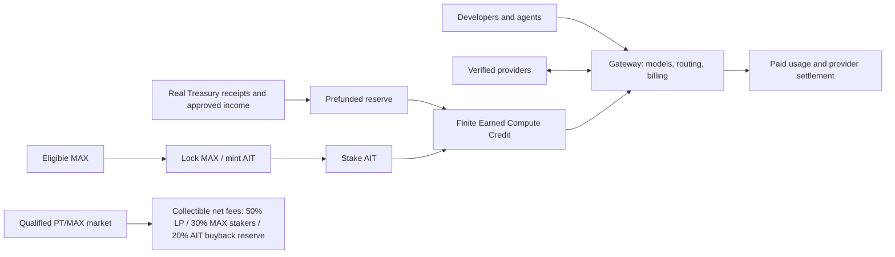

# Maxshot — Product and Tokenomics One-Pager

**Working concept | Based on `MAXSHOT_Tokens_PRD_v1.0(read only).md` (2026-11-11)**  
Proposed token terms below require founder, finance, legal and security approval before launch.

**Founder design update:** One merged MAX/AIT position per controller, exact HWM refill pricing, 18 decimals for both tokens, and a seven-day pending MAX redemption wait that restarts for all pending MAX after each burn. These are working design decisions, not launch approval.

**Launch scope:** Ethereum hosts MAX locking, AIT mint/burn and staking. MAX transfers directly among Ethereum, Base, Arbitrum One and Robinhood Chain through LayerZero. AIT stays on Ethereum at launch; its cross-chain capability is inactive. The merged position cannot transfer.

## What Maxshot is

Maxshot combines a **model-first LLM Gateway**, a market of **verified inference providers**, **agent-friendly distribution**, and an optional **MAX/AIT compute economy**. Developers and agents can pay for inference normally; holding tokens is not required. A later, qualified **provider-token (PT) market** may offer provider-specific instruments with separately documented legal rights.

## Core features

| Layer | User-facing promise | Required control |
|---|---|---|
| Gateway | Existing crypto-deposit funding, dynamic verified model catalog, one Agent per account and bounded calls | Lowest-cost eligible provider by deterministic policy; preauthorize cost and reconcile each request |
| Provider market | Real, benchmarked inference supply competing on quality, price and reliability | Verify identity, supply rights, model delivery and settlement |
| MAX/AIT | Eligible MAX can be locked to mint tradable AIT into one merged position; burn owed AIT to begin MAX redemption | Blended MAX/AIT ratio, seven-day latest-burn wait, deterministic curve, cap and anti-reset logic |
| Earned Credit | Qualified Ethereum-staked AIT earns a simple service allowance within an approved funded term | Off-chain shared account ledger; automatic seven-day epochs and grants; catalog-based model eligibility |
| Agent growth | Verified setup guide, agent budgets, finite referrals and Compute Drops | No guessed endpoints, unbounded keys or unfunded rewards |
| Optional PT market | Qualified provider-specific rights may trade against MAX | Binding rights, compliant access, provable LP/fee ownership |

## Proposed Genesis numbers

| Parameter | Working value |
|---|---:|
| MAX FDV / fully diluted supply | `$100M target / 1B MAX` (full fixed supply minted at launch into purpose-specific custody) |
| Initial MAX primary sale | `50M MAX × $0.10 = $5M` **gross** potential receipts (quantity/price confirmed) |
| AIT cap | `50,000` **outstanding** AIT |
| Mint curve | `R(S) = 600[1 + 2(S/50,000)²]` MAX per next AIT |
| Uninterrupted full-cap lock | `50M MAX` locked; marginal rate rises `600 → 1,800 MAX/AIT` |
| HWM refill | Burn does not lower peak outstanding debt; refill below peak costs `R(HWM)` and mint above peak follows the curve integral |
| MAX redemption | Proportional MAX becomes pending on AIT burn; withdraw seven days after latest burn; another burn resets the wait for all pending MAX |
| Base Earned Credit | `$12/365` per eligible staked AIT-day (`~$1/month`) **within a funded term** |
| Proposed first term | `90 days`; full-cap maximum face value `$147,945.21`, plus cost buffer |
| PT fee direction | Collectible distributable net: `50% LP / 30% qualified MAX stakers / 20% AIT buyback reserve` |

Only **actual net primary receipts** create eligible Treasury capital. MAX locks and secondary MAX/AIT purchases do not. AIT is **not** a stablecoin, cash-redeemable Treasury claim or permanent yield promise. The proposed 15% net Treasury return and 80% compute allocation are **illustrative assumptions**; the active credit term must be prefunded. Market-purchased AIT remains inventory until a debt-safe retirement rule is approved.

## Economic loop

Verified provider quality supports retained paid Gateway use. Real net operating contribution and genuine primary-sale capital can fund finite compute and growth programs. Funded AIT credits bring users to the Gateway; agent setup and capped referrals can convert them into repeat paid users. A qualified PT market could add MAX utility and AIT buyback inventory through collectible fees. Each link needs measured usage, available cash and enforceable rights; trading volume or token FDV alone cannot fund service.

## Launch order and unresolved gates

**Compute-first Gateway → audited/funded MAX/AIT Genesis → agent/referral expansion → legally qualified PT market → conditional scale.** Before token launch, supply the MAX custody allocation/vesting manifest, approve the AIT curve/cap and LayerZero security configuration, fund the 90-day Credit term, and complete Treasury accounting, legal review, contract audit and live API verification. PT issuance and its 50/30/20 fee split need separate rights and fee-capture proof. The detailed decision register is `MAXSHOT_Decision_Gaps_and_Handoff_Addendum.md`.
