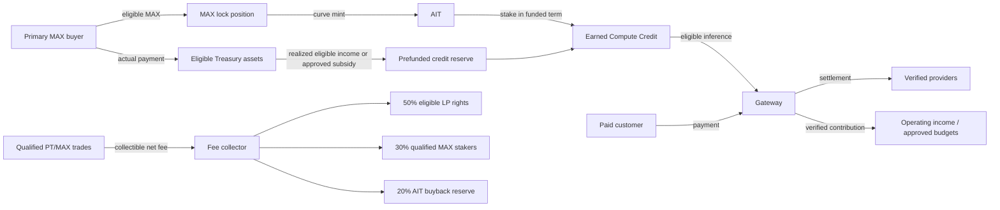

# Maxshot — Tokenomics and Economic Flywheels

**Status:** Working analytical companion to `MAXSHOT_Tokens_PRD_v1.0(read only).md` (2026-11-11). All figures below retain the source's proposed or baseline-assumption status; they are not approved offering terms or a forecast.

**Founder decision update (2026-11-11):** The active mint position is merged per controller, with uniform terms and no position time lock. A burn moves proportional MAX into a pending redemption balance. Every burn restarts a seven-day wait for the controller's entire pending balance. HWM refills use the exact two-part rule below. MAX and AIT use 18 decimals. Launch approval remains separate.

**Development-round decisions:** See `MAXSHOT_Decision_Gaps_and_Handoff_Addendum.md` for the authoritative override of older source wording on MAX eligibility, cross-chain scope, pause controls and Credit ledger behavior.

## 1. Economic map



There are **three separate economic sources**: real primary MAX receipts, external paid Gateway contribution, and collectible PT market fees. Secondary token trades move value between traders and liquidity providers. MAX locks create AIT and a collateral obligation; they are not Treasury cash receipts.

## 2. Token and balance structure

| Instrument | Supply / issuance | Holder use | Key limitation |
|---|---|---|---|
| **MAX** | Founder-confirmed fixed maximum: 1B; initial sale quantity: 50M | Any transferable MAX may return to Ethereum and lock for AIT; LayerZero transfer across the four launch chains; separate qualified stake may receive PT net fee share | FDV and locked MAX are not liquid Treasury assets; unsold/team MAX stays in restricted custody until released |
| **AIT** | User-side mint only against eligible locked MAX; proposed Genesis outstanding cap: 50,000 | Transfer, trade, stake for funded term-limited Compute Credit; burn against the controller's merged position debt to start MAX redemption | No USD/NAV redemption, peg, cash yield or unconditional permanent credit rate |
| **PT** | Optional, issuer/provider-specific and only after legal approval | Rights specified in binding instrument; potential PT/MAX trading | Ticker alone does not create equity, dividends or liquidation rights |
| **Paid Credit** | Issued against real customer payment | Pay Gateway consumption | Separate payment/refund obligation and ledger |
| **Earned Compute Credit** | Granted from an approved, prefunded term or campaign | Spend on eligible inference before expiry | Service allowance, not cash or an on-chain token by default |

MAX and AIT have different rights. AIT is fungible, but the claim to retrieve locked MAX stays with the **mint position controller**. Buying AIT in the market gives the buyer staking eligibility under program rules; it does not transfer somebody else's MAX position. MAX and AIT each have 18 on-chain decimals.

**Launch chain scope:** Ethereum mainnet hosts the non-transferable merged position, HWM, MAX lock, AIT mint/burn, seven-day MAX redemption and AIT staking. MAX has direct LayerZero routes among Ethereum, Base, Arbitrum One and Robinhood Chain. AIT remains on Ethereum at launch, with its LayerZero capability inactive pending a later release.

## 3. Genesis capital and mint curve

### 3.1 Capital formation assumptions

| Quantity | Working value | Meaning |
|---|---:|---|
| MAX fully diluted supply | 1,000,000,000 MAX | Founder-confirmed fixed maximum, fully minted on Ethereum at launch into purpose-specific custodian wallets |
| MAX FDV reference | $100,000,000 | Directional valuation reference, not cash |
| Initial implied MAX price | $0.10 | `$100M / 1B` |
| Initial primary sale quantity | 50,000,000 MAX | Founder-confirmed; 5% of maximum supply |
| Gross sale proceeds at reference price | $5,000,000 | Before fees, refunds and restrictions |
| Eligible Treasury capital | Actual net receipts | Must be independently reconciled and legally available |

The full 1B MAX is minted on Ethereum at launch into custodian wallets with distinct purposes. The wallet allocation amounts, vesting, distribution and LP plan remain deployment/commercial inputs; their manifest must sum to 1B. No later discretionary mint can increase global MAX supply. LayerZero bridge debits/credits move existing MAX across chains, with in-flight amounts included in global conservation. The AIT minter does **not** track MAX provenance: any transferable MAX, including secondary purchases, is eligible to lock on Ethereum. Unsold Treasury/team allocations remain operationally restricted in on-chain custody or vesting contracts under a documented release plan. Actual Treasury receipts are accounted for independently of MAX transfers.

### 3.2 AIT denomination and curve

The latest proposed Genesis denomination is **50,000 maximum outstanding AIT**, replacing the older 10M-unit denomination. Let `S` be uninterrupted Genesis issuance progress in AIT and `C = 50,000`.

```text
Marginal MAX per AIT: R(S) = 600 × [1 + 2(S/C)²]
Cumulative MAX lock: L(S) = 600S + 400S³/C²
MAX for a new interval [S0,S1] = L(S1) − L(S0)
```

| Uninterrupted AIT issued | Marginal MAX/AIT | Cumulative MAX locked |
|---:|---:|---:|
| 0 | 600 | 0 |
| 10,000 | 648 | 6,160,000 |
| 20,000 | 792 | 13,280,000 |
| 30,000 | 1,032 | 22,320,000 |
| 40,000 | 1,368 | 34,240,000 |
| 50,000 | 1,800 | 50,000,000 |

The exact quantity is quoted by deterministic integer contract arithmetic, with displayed rounding, slippage bounds and deadline. The table applies to uninterrupted first issuance. After burns, aggregate locked MAX must be read from positions, not inferred from `L(current outstanding AIT)`.

### 3.3 Merged position, redemption and HWM refill

Each controller has **one non-transferable active merged position** with `AIT_debt_remaining = D` and `locked_MAX_remaining = M`. All mints have the same ownership and unlock terms, so a new mint adds its AIT to `D` and quoted MAX to `M`. The displayed average backing ratio is `M/D` MAX per outstanding AIT. Every mint and burn still creates an immutable event with its quantity, quote and before/after state. AIT held in a wallet does not transfer another controller's MAX claim.

There is **no time lock on the active position**. A controller may burn any amount `b` with `0 < b <= D` at any time. For a partial burn, move `floor(b × M / D)` MAX wei from active collateral to that controller's `pending_MAX_redemption`; reduce `D` by `b` and `M` by that MAX amount. If `b = D`, move **all** remaining `M`, so rounding dust cannot strand MAX. With exact arithmetic, partial burns leave the position's average ratio unchanged; integer rounding can change the displayed ratio slightly. Selling minted AIT leaves the controller needing to reacquire AIT to close; there is no automatic liquidation.

The pending MAX is withdrawable **seven days after the latest burn**. Every additional burn adds its MAX to the same pending balance and resets the withdrawal time of the **entire still-pending balance** to `latest_burn_time + 7 days`. A matured, withdrawn amount is no longer pending and is unaffected by later burns. Pending MAX is no longer active AIT collateral and must be accounted for separately in the escrow invariant. A new mint changes only active `D` and `M`; it does not shorten an existing redemption wait.

The HWM is the **peak historical global outstanding AIT mint debt**; burning never lowers it. Let `O` be current global outstanding debt, `H` the HWM before a mint, and `q` the new AIT amount. With `C = 50,000`, require `O + q <= C` and define:

```text
newPeak = max(0, O + q − H)
refill  = q − newPeak
MAX_charge = refill × R(H) + [L(H + newPeak) − L(H)]
H_after = max(H, O + q)
```

Thus, AIT minted into the gap below the old HWM is charged at `R(H)` per AIT. The portion that crosses above the old HWM is charged by the curve integral. For example, after debt peaks at 30,000 and falls to 20,000, a 15,000-AIT mint charges the first 10,000 at `R(30,000) = 1,032 MAX/AIT` and the next 5,000 at `L(35,000) − L(30,000)`; the HWM becomes 35,000. The **50,000 cap applies to outstanding debt**, not lifetime cumulative mints. Round the exact total MAX charge **up** to the next MAX wei using deterministic integer arithmetic. Protocol AIT buybacks remain inventory until a separately approved, debt-safe retirement method exists.

**Contract handoff invariants:** at launch, with AIT confined to Ethereum and absent a separately specified recovery state, `Σ active D = outstandingMintDebt = Ethereum AIT totalSupply`; `Σ active M + Σ pending MAX = MAX allocated to user claims`; `HWM >= outstandingMintDebt` and never decreases. AIT acquired into protocol inventory remains in total supply and does not retire debt. A cross-chain MAX transfer does not affect AIT debt. If AIT bridging is later enabled, replace the local-supply equality with global supply including in-flight messages; a bridge burn is not position redemption. A partial position burn must move no more than proportional active MAX; a full burn must move all residual active MAX.

## 4. Compute-credit economics

### 4.1 Proposed funded base program

Within an expressly approved and fully funded term, **one qualified staked AIT accrues `$12/365` of USD-denominated Earned Compute Credit per day**, approximately `$1/month`. Grants post weekly and each grant expires seven days after issuance. The first proposed commitment is **90 days**; there is no perpetual entitlement.

At launch, Ethereum staking accrues from confirmed stake time, prorated for actual time staked, without warm-up. Unstaking is immediate with no cooldown, preserves accrued but ungranted Credit, and is required before AIT can be burned for MAX redemption. All stakers share seven-day intervals from the funded program's start; the final short interval also receives a grant. After Ethereum finality, the Gateway backend posts grants automatically into its **off-chain ledger**, without a user claim transaction. Each Gateway account links one verified staking wallet; changing or unlinking it is unavailable at launch. One Agent per account and the UI share the account Earned Credit balance, subject to the Agent's scoped key, model-catalog permission and spend cap. Billing uses earliest-expiring eligible Earned Credit before Paid Credit; unused preauthorization returns to its original grant with the original expiry, and expired remainder is not spendable again. A provider-fault or overcharge refund after settlement creates a new seven-day grant for the Earned portion and restores the Paid portion to Paid Credit.

```text
50,000 staked AIT × $12/year = $600,000 annualized maximum face value
50,000 × $12 × 90/365 = $147,945.21 maximum 90-day face value
```

The 90-day figure assumes every AIT is staked throughout; reserve needs also account for in-flight use, provider payables, model-cost changes and a policy buffer. “Face value” measures potential service consumption, not a cash return. Actual value to a user depends on eligible usage, grant expiry, AIT acquisition price, transaction costs and available models.

**Solvency rule:** liquid eligible fulfillment resources must cover the maximum cost of unexpired earned grants, in-flight API commitments, provider liabilities and buffer. The program must be prefunded before public commitment. If future income falls short, the already promised term remains funded; new uncommitted terms can be changed or stopped prospectively.

### 4.2 Treasury yield is a scenario

The PRD uses a **15% net annual reserve return** and **80% of that return** for compute as assumptions:

```text
$5,000,000 × 15% × 80% = $600,000/year
```

This equals the 50,000 AIT annualized face ceiling only if all $5M earns that realized net return and enough eligible liquidity exists. Holding `$147,945.21` aside for a 90-day maximum face commitment leaves `$4,852,054.79` invested. At the same hypothetical 15% and 80%, the yearly allocation becomes `$582,246.58`, a `$17,753.42` gap against `$600,000`. Provider cost and buffer may enlarge the required reserve. This is why the funded 90-day term is the design unit, with renewal subject to fresh coverage approval.

Paid Credit, Earned Credit and eligible Treasury assets need separate ledgers. Paid Gateway GMV is not profit; earned-credit calls are not external paid GMV. MAX market value, MAX locked in contracts, PT liquidity positions and unrealized marks cannot be counted as ready cash for credit fulfillment.

### 4.3 Market-buyer interpretation

An AIT buyer at `$50/AIT` would see `$12 / $50 = 24%` **annualized face-credit ratio** if continually eligible and able to use every credit. For a confirmed 90-day term, the maximum face amount is `$2.9589/AIT`, or about **5.92% of a $50 purchase price**. Neither figure is cash APY or a promise of token appreciation. The AIT purchase itself normally sends no cash to the Treasury.

## 5. Other value flows

### 5.1 Paid inference

Customers pay for real model usage. Maxshot pays the provider and retains only verified contribution after provider and operating costs. The PRD's illustrative `$2M` paid GMV, `$1.76M` provider settlement and `$120K` operating costs yields `$120K` net operating contribution. A proposed 50% of that (`$60K`) could support an approved credit budget **only if** it is incremental, settled, available and not already included in Treasury returns.

At launch, Paid Credit uses the Gateway's existing crypto-deposit flow, subject to end-to-end verification. The customer-facing model catalog expands dynamically to every verified model from supported providers; a shared model ID requires verified equivalence of version and required capabilities. Each model has one current catalog assignment, and a funded Earned Credit program permits a set of catalogs. New-call eligibility uses the catalog assignment at preauthorization; an in-flight call keeps its authorization. For a selected model, routing defaults to the lowest quoted-cost verified provider that meets capability, quality, latency and data-policy constraints, with fallback only inside the authorized maximum cost.

### 5.2 PT/MAX market

After provider qualification and legally defined PT rights, the proposed split of **collectible distributable net** launchpad fees is 50% to the eligible LP fee-right holder, 30% to qualified MAX stakers and 20% to an AIT buyback reserve. The actual AMM fee rights, LP custody, deductions and MAX stake terms must be proven before launch. A PT trade does not finance a provider's GPU purchase; primary financing is a separate transaction. Bought AIT is held; no automatic debt-unmatched burn.

### 5.3 Referrals and bonus

Referral rewards arise only from verified, attributable net economic contribution and finite approved budgets. Earn-AIT incentives use market-purchased or already owned AIT, not unbacked minting. A MAX-staking boost can weight a **separately funded bonus pool**; it cannot increase the fixed base rate without funding. The PT fee pool already sums to 100%, so an additional referral cut requires an explicit fee-policy change or another budget.

## 6. Economic flywheels and their conditions

These are **conditional mechanisms**, not automatic price or revenue guarantees.

| Flywheel | Causal sequence | What must be true / break point |
|---|---|---|
| **Compute quality → paid demand** | Verified providers improve price/quality → more retained paid inference → higher *net* operating contribution → more capacity for service and approved growth spending | Calls must be real, providers legally able to supply, pricing profitable, users retained. GMV alone is insufficient. |
| **Capital → funded compute → usage** | Primary MAX receipts create eligible Treasury assets → approved liquid reserve funds finite AIT credit → stakers try the Gateway → some become retained paid users | Net receipts, reserve coverage, useful models and conversion must be observed. Locking or trading MAX adds no capital. |
| **Agent distribution → paid usage** | Easy, budget-limited agent setup and useful shared templates → verified first calls → repeat paid consumption → attributable margin funds capped referrals | Attribution must survive fraud checks; reward costs must be below realized contribution. |
| **Provider success → PT activity → MAX utility** | Qualified provider performs → legally sound PT is offered/traded against MAX → collectible fees fund LP rights, qualified MAX stakers and AIT buyback inventory | PT rights, trading permissions, fee capture and liquidity must exist; token volume by itself is not provider revenue. |
| **AIT liquidity → access to compute program** | Original minters can sell AIT → buyers may stake under active program → broader credit-user base may generate product discovery | Program must be funded; secondary buyers do not recapitalize Treasury; speculation may raise closeout cost for minters. |

The flywheels should be measured with paid retention, verified provider cost/quality, net receipts, reserve coverage, funded grants, conversion from earned to paid use, collectible PT fees and referral contribution. Price and trading volume are separate market metrics.

## 7. Decisions before publication or launch

1. Supply the purpose-specific MAX genesis wallet manifest and custody/vesting implementation, and finalize sale/legal terms. Full 1B MAX issuance at launch, the fixed cap, 50M sale at $0.10 and secondary-transfer eligibility are confirmed.
2. Complete simulation and audit of the founder-approved merged position, exact HWM refill, seven-day redemption wait, non-transferability and 18-decimal arithmetic; separately approve the AIT denomination, 50,000 cap and curve for launch.
3. Approve 90-day term wording, eligible model-catalog set/cost caps, liquidity reserve and stress buffer. Ethereum-only immediate time-weighted staking, automatic program-wide weekly grants, shared account Credit and refund/spend rules are decided.
4. Finalize LayerZero endpoint/lane/security configuration for the four-chain MAX launch; AIT remains Ethereum-only at launch, with its peer deployment deferred to operations.
5. Diligence Treasury custody, net yield assumptions, statutory accounting and jurisdiction-specific token/credit treatment.
6. Define qualified MAX staking and PT fee rights; prove AMM fee capture and LP ownership.
7. Define PT instruments provider by provider, including enforceable rights and investor/transfer restrictions.
8. Establish a debt-safe policy for AIT buyback inventory before any burn claim.

**Release test:** no AIT grant without funded coverage; no MAX movement into pending redemption without matching debt burn; no pending MAX withdrawal before its latest-burn deadline; no mint from restricted MAX; no HWM reset; no fee distribution beyond collectible net fees; no public claim that proposed contracts, APIs or rates are live until verified.
