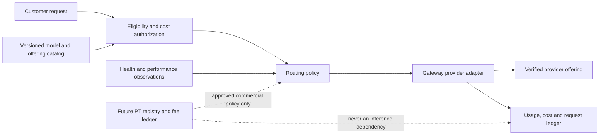

# Maxshot Multi-Provider Routing Design

**Status:** Product architecture updated 12 November 2026. Launch routing rules are decided; Auto weights and any Provider Token routing influence remain separate future decisions.
**Roles:** User (service consumer) -> Maxshot Gateway -> Provider (model capability supplier). OpenRouter is one provider. Maxshot does not expose an additional aggregator role.

**Companion:** [Provider onboarding: launch minimum](./PROVIDER_INTEGRATION_MINIMUM_STANDARD.md) defines the small admission and integration gate. This document defines how admitted offerings are routed and how Provider Tokens (PT) could connect later.

## System boundary

The hot path reads a versioned, cached policy snapshot. It never waits for a chain, token price feed, AMM, or PT balance query to serve an inference request. Missing or stale PT data means zero token preference, not a failed compute request.

## Provider-model catalog

- Every provider-model offering has a unique, stable ID. Store provider ID, provider-native model ID and version, supported input/output modalities, controls, context and output limits, price schedule, cost schedule, health state, and eligibility. Do not infer equivalence from similar model names.
- Providers may supply any modality or capability that a Maxshot adapter can validate and serve. Capability and billing rules attach to each offering, not to the provider as a whole.
- A user may pin a specific provider-model offering. An explicit selection must not silently become another offering. Auto may select both provider and model from an approved offering pool; the selected offering is shown before the request and in the response/usage record.
- For this release, Auto applies to **web text Chat only**. Studio image/video and API requests remain explicitly selected. A future Auto policy for those surfaces requires its own approval.

## Routing policy by request mode

1. **Hard gates for every mode:** request modality and controls, exact model identity/version, account/plan/catalog eligibility, privacy and region policy, provider health/capacity, customer price and authorized charge ceiling, spending limit, and provider cost/risk ceiling. A failed gate cannot be offset by a score, token holding, or commercial payment.
2. **Explicit offering pin:** use that offering if it passes every gate; otherwise report it unavailable. Do not silently switch providers or models.
3. **Customer-selected model without provider pin:** choose the lowest quoted provider cost among qualified equivalent offerings for that model, using a stable offering ID to break exact ties. This is the launch default decided in the [token handoff](./MAXSHOT_Decision_Gaps_and_Handoff_Addendum.md). Quality, latency and data policy are gates, not optional score tradeoffs.
4. **Auto model selection in web text Chat:** use the separately approved [Auto Model Routing Design](./AUTO_MODEL_ROUTING_DESIGN.md) to choose an offering from the evaluated Auto pool. The base ranking considers task fitness, observed quality, reliability, latency and cost after every hard gate. Other surfaces do not inherit Auto.
5. **Dispatch and failover:** freeze the selected offering, price, catalog and policy versions for the accepted request. A retry of that offering keeps the same customer authorization. Switching to another equivalent offering requires an explicit accepted failover policy or a new user-authorized request; it must remain under the original ceiling.

This resolves an ambiguity in the earlier draft: performance ranking applies to the approved Auto mode, while the ordinary chosen-model route remains lowest qualified provider cost. Any change to that default is a new product decision, not an implication of PT integration.

## Minimal resilience improvement for approval

[OpenRouter's routing overview](https://openrouter.ai/blog/insights/model-routing/) separates model selection, provider selection and the two kinds of fallback. Its [current traffic-routing documentation](https://openrouter.ai/docs/guides/providers/traffic-routing) also uses recent reliability, 429 capacity rejects, latency and effective price; it is more involved than the blog's inverse-square example. Maxshot should adopt the **separation and safeguards**, not copy that weighting algorithm or build a large ranking engine for launch.

1. **Same-model provider fallback:** propose a standing, disclosed failover policy allowing at most one backup offering after a pre-output 429, 5xx, connection failure or timeout. The backup must be a verified equivalent model/variant, support every required parameter and data rule, and fit the original customer charge and aggregate provider-cost ceilings. An explicit provider pin disables this fallback unless that user has authorized a backup list. This is a proposed default policy; the current design does not silently authorize it.
2. **Cross-model fallback:** keep disabled by default. For an optional future Auto setting, present an ordered, approved backup-model list and the maximum charge before submission. Recheck catalog and plan eligibility on each backup, report the actual serving model, and never use a moderation or context error to switch to a different model without that prior authorization. [OpenRouter's model-fallback feature](https://openrouter.ai/docs/guides/routing/model-fallbacks) is a useful pattern, but its default trigger set is broader than Maxshot should accept.
3. **No duplicate output or charge:** do not retry after customer-visible stream output begins. Do not resubmit an asynchronous media job whose acceptance status is unknown. Record each attempt and settle the customer once; track provider charges even when a failed or cancelled attempt costs Maxshot money.
4. **Light health backoff:** temporarily remove an offering from new routing after a short burst of provider faults or 429s, while preserving manual disable. Track provider faults, capacity rejects, user-input errors and customer cancellations separately. The launch policy needs an operations-owned threshold, not a learned traffic-share engine.

For the launch lowest-cost decision, compare a versioned **request-specific provider cost estimate** using the rate card and relevant usage/caching terms where known, not just one headline token price. The accepted customer quote remains fixed. Unknown cost or unsupported controls makes an offering ineligible.

Healthy new offerings may receive a small, spend-capped exploration allocation to collect performance data. Exploration remains subject to every hard gate and user-facing cost rule. Disable a failing offering promptly; do not promote an untested provider because it lacks negative history.

## Future Provider Token integration

**Recommended first PT connection: economic integration without routing bias.** Link an approved `pt_instrument_id` to a qualified `provider_id` in a separate PT registry. Record the token's issuer, binding rights documents, allowed holders/transfers, chain and contract, and any PT/MAX pool and fee-collector references. The provider's compute eligibility and model quality still come only from delivery evidence. PT issuance, trading volume, price and TVL do not increase route eligibility, customer price, or provider payout.

If a qualified PT/MAX market is later approved, its fee ledger may allocate **only collectible distributable net fees** under the proposed 50% eligible LP/fee-right holder, 30% qualified staked MAX, and 20% AIT buyback-reserve direction. The PT registry and fee collector stay separate from the inference request and provider payable ledgers. Market-bought AIT goes to inventory; it is not burned without debt-safe settlement. PT secondary trading does not finance the provider by itself. These mechanics require the source PRD's per-provider legal rights, LP ownership and AMM fee-capture proof before launch.

**Optional later routing connection:** PT status may supply a bounded commercial preference **only in an approved Auto cohort**, never for an explicit offering pin or the ordinary lowest-cost chosen-model route. It is an experiment, not a default property of PT ownership:

1. Start with candidates that passed all hard gates and published performance floors. Compare each with the no-PT Auto winner on quality, success, latency and customer/provider cost. Only near-equivalent candidates inside approved limits may be considered.
2. Use a versioned, verified commercial signal tied to a documented provider program; token price, raw volume, or TVL alone are not valid evidence. Ignore wash or self-dealing activity. Define the signal's data source, freshness, anti-manipulation checks, and maximum adjustment before enabling it.
3. Cap the adjustment, influenced traffic share and incremental provider spend. Record the base winner, adjusted winner, reason and policy version per request. Disclose promoted placement and serving provider to the user when the adjustment changes selection.
4. Run the policy in shadow mode, then a small randomized cohort with a no-PT control. Compare delivered success, p95 latency, task quality, customer charge, Maxshot margin, provider concentration and user retention. Disable preference if approved limits are breached.

This gives PT an optional commercial utility without representing token market activity as inference quality. It also lets Maxshot ship the provider network before deciding whether a routing preference is desirable at all.

## Tokenomics boundary

- Provider-issued tokens are optional provider-side instruments. Token price, trading volume and TVL are not inference-quality measures or funding sources for Maxshot user rewards. Any future commercial signal needs verified provenance, manipulation checks, caps and disclosure.
- Keep performance and commercial influence independently visible in routing audits. Disclose promoted placement in the product when token-based preference materially affects Auto selection. Track its effect on user cost, quality, success rate, and retention; disable it if those deteriorate beyond approved limits.
- PT tokens are not AIT reserves, and provider TVL is not Maxshot revenue. AIT bought with approved fee proceeds is held as inventory; it is not burned without debt-safe settlement. Compute Credit obligations require their own funded reserve under the token handoff.
- Do not offer provider-funded routing influence to explicit-model users. No provider can pay or stake its way around the hard gates.

## Backend and frontend ownership

- The native LLM gateway handles provider execution, dispatch, and raw request/attempt observations. Shared backend services persist provider configuration, admission, funding reservations, and settlement. Maxshot product services own user entitlement and user-facing account/usage views. New API is not part of this architecture.
- All provider attempts share a stable Maxshot request ID. Record the chosen offering, policy and price versions, attempt status, provider cost, final customer charge, and whether a commercial boost influenced selection. Multiple attempts must not create duplicate customer deductions.
- Frontend changes remain narrow: show the selected provider-model pair and quoted ceiling for Auto, preserve explicit offering selection, and disclose serving provider, failover, and promoted placement in relevant usage details. Do not add a separate provider selector solely for this design.
- Customer price and authorization must be determined before dispatch and remain stable for the accepted request. Provider cost differences are Maxshot routing economics, not a reason to silently change the customer's charge.

## Data and measurement interface

Each route decision persists: `request_id`, `attempt_id`, request mode, customer-facing model ID, selected and serving offering IDs, equivalent-model mapping version, catalog/price/policy versions, eligibility results, quoted ceiling, provider cost quote, base winner, any PT-adjusted winner and adjustment, failover authorization, final usage, customer charge and provider payable. Sensitive prompt/output content is excluded from routine route telemetry. This record must reproduce why the provider was selected.

Monitor by offering and request class: delivered success, p50/p95 latency, throughput or media completion, usage completeness, provider cost variance, invoice reconciliation and model-identity incidents. The [launch minimum](./PROVIDER_INTEGRATION_MINIMUM_STANDARD.md) defines the first four required operations measures; quality evaluations and causal PT experiments add later evidence. A small sample is displayed as insufficient data, never as a top ranking.

## Rollout and acceptance

1. Normalize OpenRouter and one additional provider into the same offering schema; pilot a few text offerings using the chosen-model lowest-qualified-cost rule.
2. Run Auto's performance ranking in shadow mode, then a limited web text-Chat cohort. Add route health, cost and quality monitoring, and idempotent billing reconciliation.
3. Expand eligible providers and modalities only after capability, job-state, metering, and settlement tests pass. If PT is later launched, connect its registry and fee accounting first. Consider a token-linked routing experiment only after separate approval and shadow evidence.

Acceptance: explicit selection stays pinned; Auto selects only eligible approved offerings; selected and serving IDs are traceable; provider failures do not change capabilities or cause duplicate customer charges; commercial preference cannot override any gate or approved performance floor.

## Open parameters

- First additional provider and pilot offerings.
- Evaluation dataset, performance weights/windows, minimum sample sizes, exploration cap, and route cost/risk ceiling.
- Token metric definitions and sources, maximum boost, disclosure threshold, abuse controls, and launch authorization.
- Whether PT should ever influence Auto routing at all; if yes, approved near-equivalence bands, traffic/spend caps, commercial signal and experiment stop criteria.
- Whether any user-authorized fallback may substitute a different offering after a failure; the default is no silent substitution.

## Version history

| Date | Change |
|---|---|
| 2026-11-12 | Applied OpenRouter research: separated provider and model fallback, added capability/data/cost constraints and a small health-backoff proposal without importing weighted routing. |
| 2026-11-12 | Distinguished launch chosen-model routing from Auto scoring; added PT registry/fee integration and optional bounded Auto experiment. |
| 2026-11-04 | Aligned backend ownership with the native LLM gateway after New API retirement. |
| 2026-11-04 | Documented the agreed provider-model identity, hard-gate-first routing, performance score, and separated tokenomics preference. |
