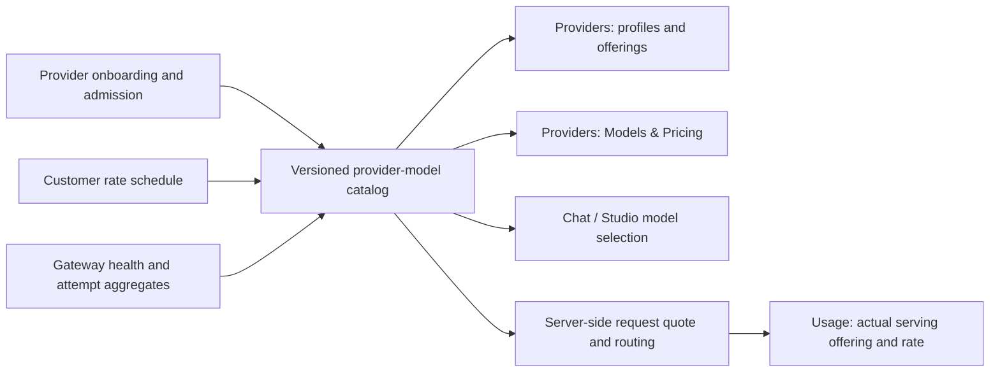

# Providers frontend data contract

**Status:** Product-to-development handoff, updated 15 November 2026. This specifies the read data needed to replace the prototype's simulated catalog across Providers, Chat and Studio. It does not create a separate public quote endpoint; the companion routing design and token addendum govern authorization, onboarding, and token rules. The example JSON and field names are a suggested frontend mapping, not a mandated internal schema.

**Sources:** [Provider onboarding launch minimum](./PROVIDER_INTEGRATION_MINIMUM_STANDARD.md), [multi-provider routing](./MULTI_PROVIDER_ROUTING_DESIGN.md), and decisions TD-23/26–31/34–35 in the [handoff addendum](./MAXSHOT_Decision_Gaps_and_Handoff_Addendum.md). The [prototype catalog](../frontend/src/data/providerCatalog.js) is illustrative only. This repository does not contain the production Gateway backend, so live endpoint names and existing response fields are unverified.

| Evidence in this checkout | Handoff implication |
| --- | --- |
| `frontend/src/data/providerCatalog.js` now exports a simulated `providerSnapshot` with provider, model, and **per-offering** records in this contract's shape. Small presentation mappings feed the existing screens. | Replace the fixture with the Gateway read snapshot. Preserve per-offering capabilities/limits, decimal-string prices, explicit units, versions, and admission/availability states. |
| `model-strategy/` contains model-reference tooling, not the production Gateway catalog service. | Do not treat reference metadata or upstream price feeds as an admitted Maxshot offering or an approved retail rate. |
| Product docs decide onboarding gates, routing, pricing, and evidence display. | Engineering must map these decisions to actual Gateway records and confirm which read outputs already exist. |

## 1. Scope and ownership



The Gateway owns provider identity, offering admission, availability, customer price, and observed performance. The frontend renders a **single versioned read snapshot** of those records. The server remains authoritative for request eligibility, the accepted quote, allowed fallback, and final charge. A catalog page price is informational; it does not authorize a request.

The public launch catalog contains only **admitted offerings**. The prototype also displays explicitly labeled admission-pending sample rows to demonstrate the state; those rows must not become routable or appear as active production prices. Provider costs, credentials, endpoints, contacts, payout terms, raw attempts, and invoice details stay internal.

## 2. Minimum read entities

| Entity | Required frontend fields | Source / rule |
| --- | --- | --- |
| Provider | `providerId` (stable), display name, route type (`direct` or `aggregator`), approved public summary, optional brand mark | Onboarding gate 1; do not publish private contract or contact data. Derive offering count and model focus from the catalog rather than maintaining separate counts. |
| Customer model | `modelId` (stable customer-facing ID), approved `displayName` and description, exact verified version, modality, `catalogId`, list of offering IDs, and web-Chat eligibility label when applicable | One current Credit catalog assignment per model (TD-23). The Gateway owns the display name and any Basic/Premium/Free Chat label; the frontend must not infer allowance coverage from a provider name or model ID. Merge provider aliases only after version and required capability equivalence are verified (TD-27). Provider discovery may retain an admitted model that is temporarily unavailable; Chat/Studio new-request lists omit it (TD-41). |
| Provider-model offering | `offeringId` (stable, never reused), `providerId`, `modelId`, public variant/tier label, admission status, availability, current-viewer policy eligibility, verified capabilities, limits, region/data policy, current customer rate-card version, optional observed performance | Identity, capability, and policy attach to the **offering**, not the provider or model alone. One provider may have admitted text while media remains pending. A viewer-scoped picker treats missing policy eligibility as ineligible; the server remains authoritative at dispatch. |
| Customer rate card | `rateCardVersion`, currency, effective time, billable components with amount and unit, and any applicable mode/resolution/condition | One complete customer schedule per offering (TD-34). Keep provider cost schedules internal. Do not synthesize a model price from rates of different providers. |
| Performance summary | Measurement window, dispatched attempt count, delivered-success percentage when supportable, latency metric (`first_token` or `completion`), latency sample count, p50/p95 in milliseconds when supportable | Computed from Maxshot attempts, per offering. The backend returns null percentages/percentiles when the sample is insufficient; the UI shows the count and **Insufficient data**. Do not infer performance from admission tests or provider claims. |

`admissionStatus` is `pending`, `passed`, or `failed`. `availability` is `available` or `unavailable` with a short public reason such as `paused` or `unhealthy`; it is independent of admission. An offering can be admitted yet temporarily unavailable. The viewer-scoped `policyEligible` example field is true only when the Gateway permits that viewer to request the offering under current region/data rules; absence is ineligible for a picker. Only a passed, enabled, healthy, policy-eligible offering may enter a live route. Public listing of failed/pending offerings is not required at launch.

Use decimal **strings** for money, explicit billing units (for example `per_1m_tokens`, `per_image`, `per_megapixel`, `per_second`), and UTC timestamps. Zero is a real free component; `null` or omission means unavailable or not applicable. A “from” display is derived from a complete conditional schedule and must never be treated as the final request quote.

## 3. Read snapshot shape

The Gateway may deliver this through its existing catalog service or equivalent internal frontend read endpoint. The exact URL and storage design are implementation choices. The fields and joins below are the contract:

```json
{
  "catalogVersion": "catalog-42",
  "generatedAt": "2026-11-14T00:00:00Z",
  "providers": [
    {
      "providerId": "provider_example",
      "name": "Example Provider",
      "routeType": "direct",
      "summary": "Approved public provider description."
    }
  ],
  "models": [
    {
      "modelId": "example/model-v1",
      "displayName": "Example Model v1",
      "chatEligibilityIndex": "P",
      "verifiedVersion": "v1",
      "modality": "text",
      "description": "Approved public model description.",
      "catalogId": "catalog_text",
      "offeringIds": ["offering_example_v1"]
    }
  ],
  "offerings": [
    {
      "offeringId": "offering_example_v1",
      "providerId": "provider_example",
      "modelId": "example/model-v1",
      "variantLabel": "Standard",
      "admissionStatus": "passed",
      "availability": "available",
      "policyEligible": true,
      "capabilities": ["streaming", "tools", "json"],
      "limits": { "contextTokens": 128000, "maxOutputTokens": 8192 },
      "dataPolicy": { "regions": ["US"], "retentionLabel": "Reviewed policy label" },
      "customerRateCard": {
        "rateCardVersion": "retail-7",
        "currency": "USD",
        "effectiveAt": "2026-11-14T00:00:00Z",
        "components": [
          { "kind": "input_tokens", "amount": "1.25", "unit": "per_1m_tokens" },
          { "kind": "output_tokens", "amount": "5.00", "unit": "per_1m_tokens" }
        ]
      },
      "performance": {
        "windowStart": "2026-11-07T00:00:00Z",
        "windowEnd": "2026-11-14T00:00:00Z",
        "dispatchedAttempts": 280,
        "deliveredSuccessPercent": "99.3",
        "latencyMetric": "first_token",
        "latencySamples": 278,
        "p50Ms": 410,
        "p95Ms": 920
      }
    }
  ]
}
```

This example defines shape, not an actual provider, verified model, rate, or performance result. Media offerings use the same identity and status fields, with relevant media capabilities, limits, and billable components. Conditional rate cards must expose their complete approved conditions, not just a minimum headline rate.

## 4. Screen mapping and behavior

| UI surface | Read fields and behavior |
| --- | --- |
| Provider profile | Join `providerId` to offerings and models. Show approved summary, route type, and a derived model/approved-offering count. List each admitted model; opening one selects its exact `modelId` in Models & Pricing. |
| Offering comparison | Group by exact `modelId` and show each provider's `variantLabel`, admission, current availability, verified capabilities/limits, and reviewed region/retention. Show delivered success and p50/p95 only when returned; otherwise show **Insufficient data** with window and counts. Never show provider-level aggregate performance as if it applied to all models. |
| Models & Pricing | Group by exact model/version. Open one model to compare **complete customer rate cards by offering**; include currency, units, conditions, and rate version/effective time. Mark unavailable offerings without implying that the displayed rate makes them selectable. Do not show internal provider cost. |
| Chat / Studio model picker | Gateway supplies only currently usable models with admitted, available, policy-eligible routes. Omit unavailable models rather than showing disabled choices. Maintain at least five distinct usable models per enabled text, image, and video catalog (TD-41); two offerings of one model do not count as two models. Historical records may still name a removed model, but new requests must choose from the current list. Catalog eligibility remains an independent account/program check. |
| Request quote and Usage | Chat and Studio show the server-selected `offeringId`, rate-card version, estimate, hard maximum and maximum funding split before submission. API uses one call: the Gateway calculates and reserves that full maximum before dispatch, enforces the optional caller ceiling and account/API-key limits, and rejects unaffordable requests without provider execution. The final customer charge may exceed the estimate but never the accepted maximum; provider overrun is recorded separately. Usage records selected and actual serving `offeringId`, actual rate version, verified units, funding sources, final charge, released hold, and whether fallback occurred. The frontend never recomputes a binding quote from catalog display rates. |

For a catalog refresh, use `catalogVersion` to replace the displayed snapshot coherently. A model, rate, capability, or policy change makes an offering ineligible until reviewed; an in-flight request retains its accepted catalog and price versions. The UI must not retain a stale rate as a current quote after a version change. Public discovery may show more offerings than a viewer may request, but the viewer-scoped picker list must use the same version and require at least one passed, available, policy-eligible route per model.

## 5. Backend output checklist

The **product rules** above are decided. The following are implementation outputs to verify in the live Gateway, not new strategy decisions:

1. Map the existing configured model/provider records to stable `providerId`, `modelId`, and `offeringId`, including native ID/version and equivalence evidence kept internally.
2. Expose one versioned frontend read snapshot containing provider public fields, model membership, per-offering admission/availability, vetted capabilities/limits/policy, and full customer rate cards. Confirm the existing catalog endpoint can serve it or add the smallest internal read surface.
3. Compute per-offering seven-day (or published configured window) delivered success and latency summaries from Gateway attempts. Return sample counts and null unsupported metrics. Confirm operations' per-offering minimum sample policy before numeric metrics are shown.
4. Use the [B2 request authorization/settlement handoff](./REQUEST_AUTHORIZATION_SETTLEMENT_HANDOFF.md) for the accepted quote, single-call API, maximum hold, serving trace, settlement and reversal proof. Expose API route/rate metadata in the response where compatible and always in Usage. Keep internal provider cost and attempt ledger separate.
5. Replace the `providerSnapshot` fixture in `frontend/src/data/providerCatalog.js` only after those read outputs exist; keep the profile, comparison, and pricing screens on the same snapshot and presentation mapping.

### B1 catalog acceptance matrix

| Gateway catalog change | Providers and pricing | Chat/Studio new requests and API | History |
| --- | --- | --- | --- |
| Admit a new offering for an existing verified model | Show it under its provider and the exact `modelId`, with its own customer rate card | Add it as an eligible route only after availability and viewer policy pass; model appears once in its modality picker | Existing records unchanged |
| Admit a new verified model with a complete display name, catalog assignment and offering | Show the new model and rate card from the same `catalogVersion` | Add it to the matching picker and API list without a separate frontend model-name registry | Existing records unchanged |
| Pause, fail, or make one offering policy-ineligible | Show the offering's current status; retain its rate as informational | Remove that route immediately; retain the model only if another eligible offering exists | Existing records remain readable |
| Remove the last eligible offering for a model | Keep the model discoverable only where product listing rules permit, marked unavailable | Omit the model from new-request pickers and reject its API selection before provider dispatch | Old conversation/creation names and Usage remain readable |
| Publish a new rate or catalog version | Show the new version and effective time together | Refresh the picker coherently; server re-quotes before a new request and rejects a stale accepted maximum | In-flight requests keep accepted versions |

**B1 verification:** Engineering supplies one versioned Gateway snapshot and demonstrates these transitions using the same model and offering IDs across Providers, Chat, Studio, and API. Compare each new-request list to the server's authoritative eligibility response. Do not count two offerings of one model as two usable models; maintain at least five distinct usable models per enabled catalog. The prototype exercises status-derived membership with simulated data, but this checkout cannot verify live Gateway output or account policy decisions. Quote, fallback, and settlement acceptance continue under B2.
