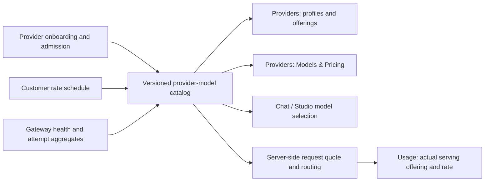

# SPEC_PROVIDERS — provider admission, catalog, routing and pricing display

**Status:** Canonical specification, compacted 16 November 2026. Every rule has one ID (`PRV-Rnn`) and is stated once; reasons are in the cited TD rows of [DECISIONS.md](./DECISIONS.md). Absorbs the provider rules formerly in Gateway PRD §P0.7 and Studio PRD §5.3. Request quote, hold, settlement and refunds are owned by [SPEC_BILLING](./SPEC_BILLING.md); this file cites `BIL-` rules instead of restating them. Auto model selection is a post-launch pilot ([reference](./reference/AUTO_MODEL_ROUTING_DESIGN.md)).

**Release:** Foundation (build-order steps 1 and 3). Roles: customer → Maxshot Gateway → provider. OpenRouter is one provider; Maxshot exposes no separate aggregator role.

## Overview

A provider becomes usable one **offering** at a time: one endpoint or variant serving one verified model version, with its own capabilities, data policy, limits, customer rate card and internal cost card. Each offering passes a small admission gate before it can carry traffic. Admitted offerings feed one versioned catalog that Providers, Models & Pricing, the Chat and Studio pickers and the API all read. For a model the customer chooses, the Gateway picks the cheapest qualified offering, or the one the customer pinned, and may try one equivalent backup if the first fails before any output. Provider Tokens have no effect on routing at launch.

```text
admit offering (6 gates, evidence packet) → versioned catalog → picker / Models & Pricing / API
request → hard gates → pinned offering or lowest quoted cost → ≤1 same-model backup if unpinned → settle (SPEC_BILLING)
```

## 1. Admission

- **PRV-R01 · Launch-ready.** A provider is launch-ready when Maxshot can identify it, configure at least one verified offering, execute and meter a real request through the existing Gateway, charge the customer once, account for provider cost and disable the offering when it fails. A self-service portal, benchmark platform, ranking engine and Provider Token features are not part of this gate.
- **PRV-R02 · Approval is per offering.** A provider's other models and variants do not inherit approval. Discovering a model does not publish it. A model name alone does not establish version or capability equivalence. A provider's own readiness flag may pause an offering but never bypasses Maxshot approval.
- **PRV-R03 · One route publishes a model (TD-28).** One admitted, available offering is enough to publish a customer model; a second is preferred for resilience, not required.
- **PRV-R04 · Shared model IDs (TD-27).** Two offerings share a customer model ID only after Maxshot verifies the same model version and required capabilities; otherwise they are separate models.
- **PRV-R05 · Sole route unavailable (TD-41).** When a model's last eligible offering becomes unavailable, remove the model from new-request pickers and reject it in the API before dispatch; keep history readable; never substitute another model.

### 1.1 Six launch gates

- **PRV-R06 · Gates.** Every offering passes all six gates before carrying traffic:

| Gate | Minimum evidence | Owner |
| --- | --- | --- |
| 1. Commercial and data permission | Provider identity and contact, accepted terms or contract, right to route or resell the exact model, allowed regions and retention, payout terms | Business/operations |
| 2. Working connection | Endpoint, authentication stored as a secret, rate limits, timeout, one successful authenticated call through the Gateway's provider interface | Engineering |
| 3. Verified offering | Stable provider ID and endpoint variant, native model ID, version and material variant (such as quantization or service tier), customer model mapping, supported modality and controls, context or output limits, provider price and unit, price version | Product + engineering |
| 4. Scripted admission test | Repeatable test of model identity, advertised controls, valid output, usage and price, invalid request, rate limit, timeout, and streaming or job completion where offered; unsupported parameters are rejected, never silently ignored; output quality reviewed manually (TD-29) | Engineering + product |
| 5. Metering and settlement | Provider request ID, billable units, provider cost under the agreed rate card, one customer charge; append-only attempt, cost, correction and dispute records; manual invoice reconciliation (TD-30) | Finance + engineering |
| 6. Safe operation | Enable, disable and remove from routing without a deployment; unhealthy offerings stop receiving new traffic; support has a provider contact and request trace | Operations + engineering |

### 1.2 Adapter contract

- **PRV-R07 · Reuse the adapter.** Use the Gateway's existing provider adapter where it can represent the offering; add a provider-specific adapter only for protocol differences. No new public customer API or provider self-service API is required.

```text
Configuration: provider_id, endpoint/secret reference, native_model_id,
  verified_model_version, customer_model_id, capabilities, region/retention,
  provider_rate_card_version, limits, enabled/disabled status.
Input to provider: request_id, attempt_id, native_model_id, supported
  parameters, timeout, provider cost ceiling.
Result from provider: native_request_id, completed/failed status, normalized
  output or error class, billable usage with units, timing.
```

- **PRV-R08 · Terminal state and usage.** A streaming adapter identifies terminal success or failure and returns final usage. An asynchronous media adapter identifies the job and its terminal status (required only for launched media offerings). Missing or late usage keeps the charge pending reconciliation; never invent billable units. Routine telemetry stores IDs and metrics, not prompt or output content.
- **PRV-R09 · Media admission bound.** An asynchronous media offering is admitted only if its declared maximum job time plus the grace window is under 24 hours (BIL-R37).
- **PRV-R10 · Upstream routers (TD-58).** When an upstream such as OpenRouter routes among its own endpoints, pin its approved endpoint, disable its own provider and cross-model fallback, require supported parameters, data policy and a provider-cost ceiling, and capture the serving endpoint it reports. If it cannot meet all of these requirements, it is not admitted or routed at launch, including for an explicitly pinned request.
- **PRV-R11 · Media routing layer.** Image and video generation go through a provider routing layer that accepts a generation request, returns a job result and reports cost and status for metering, under the same offering and admission rules. Media requests are not forced through the Gateway's chat-completion endpoint.

### 1.3 Onboarding evidence

- **PRV-R12 · Evidence packet per offering.** Keep one repeatable packet per offering:

| Item | Evidence to retain |
| --- | --- |
| Permission | Approved right to serve or resell this exact model, region and data policy, provider contact, payout terms |
| Offering record | Stable provider, customer model and offering IDs; native version and variant; verified controls and limits; customer and provider rate-card versions |
| Live call | One authenticated Gateway request with valid output and verified usage; request and attempt IDs, not prompt or output content |
| Billing trace | The same request linked to its provider attempt, provider cost, funding hold and exactly one customer charge |
| Failure and disable | Unsupported-parameter rejection, rate-limit and timeout handling, duplicate callback safety, manual disable with no new request reaching the offering |
| Upstream pinning | For an upstream router, proof that its endpoint is pinned and its own fallback disabled (PRV-R10) |

- **PRV-R13 · Controlled enablement.** After manual review of the scripted result and output quality, enable the offering for a limited-volume or spend-capped cohort first.
- **PRV-R14 · First statement before payout (TD-30).** Reconcile the provider's first statement against the append-only attempt, cost, correction and dispute records before paying; link corrections instead of editing history. The first invoice is not a prerequisite for the first controlled request.
- **PRV-R15 · Platform proof, once.** Admit a second offering for the same verified model and capabilities to prove the shared route once (§7.2). A second offering is not required for every published model.

## 2. Catalog data contract (formerly B1)

### 2.1 Scope and ownership



- **PRV-R16 · Ownership.** The Gateway owns provider identity, offering admission, availability, customer price and observed performance. The frontend renders one versioned read snapshot. The server stays authoritative for eligibility, the accepted quote, fallback and the final charge; a catalog price is informational and never authorizes a request. Field names below are a suggested mapping, not a mandated schema.
- **PRV-R17 · What is public.** The public launch catalog lists only admitted offerings. Provider costs, credentials, endpoints, contacts, payout terms, raw attempts and invoices stay internal. The prototype's labeled admission-pending rows are never routable or shown as live prices.

### 2.2 Minimum read entities

- **PRV-R18 · Entities.**

| Entity | Required frontend fields | Rule |
| --- | --- | --- |
| Provider | `providerId` (stable), display name, route type (`direct` or `aggregator`), approved public summary, optional brand mark | No private contract or contact data. Derive offering counts and model focus from the catalog. |
| Customer model | `modelId` (stable), approved `displayName` and description, verified version, modality, `catalogId`, offering IDs, Basic/Premium/Free label where applicable | One current catalog assignment per model (TD-23). The Gateway owns display name and label; labels also govern API text funding (BIL-R06). The frontend never infers allowance coverage from a provider name or model ID. |
| Offering | `offeringId` (stable, never reused), `providerId`, `modelId`, variant label, admission status, availability, viewer policy eligibility, verified capabilities, limits, region and data policy, current rate-card version, optional observed performance | Identity, capability and policy attach to the offering. One provider may have admitted text while its media is pending. |
| Customer rate card | `rateCardVersion`, currency, effective time, billable components with amount, unit and any mode/resolution condition | One complete schedule per offering (TD-34). Provider cost schedules stay internal. Never combine components from different offerings into one model price. |
| Performance summary | Window, dispatched attempts, delivered-success percent when supportable, latency metric (`first_token` or `completion`), latency sample count, p50/p95 ms when supportable | Computed from Maxshot attempts per offering; null when the sample is too small (PRV-R34). |

- **PRV-R19 · Status fields.** `admissionStatus` is `pending`, `passed` or `failed`. `availability` is `available` or `unavailable` with a short public reason (`paused`, `unhealthy`), independent of admission. `policyEligible` is true only when the Gateway lets this viewer request the offering under current region and data rules; absence means ineligible. Only a passed, enabled, healthy, policy-eligible offering enters a live route. Listing failed or pending offerings publicly is not required.
- **PRV-R20 · Money and units.** Money is a decimal string with an explicit unit (`per_1m_tokens`, `per_image`, `per_megapixel`, `per_second`) and UTC timestamps. Zero is a real free component; `null` or omission means not available. A "from" price derived from a conditional schedule is never a request quote. Conditional rate cards expose all approved conditions, not only the lowest headline rate.

### 2.3 Read snapshot shape (example)

The Gateway may serve this from its existing catalog service or the smallest internal read surface; URL and storage are engineering choices. The example shows shape only, not a real provider, model, rate or result. Media offerings use the same fields with media capabilities, limits and billable components.

```json
{
  "catalogVersion": "catalog-42",
  "generatedAt": "2026-11-14T00:00:00Z",
  "providers": [
    {
      "providerId": "provider_example",
      "name": "Example Provider",
      "routeType": "direct",
      "summary": "Approved public provider description."
    }
  ],
  "models": [
    {
      "modelId": "example/model-v1",
      "displayName": "Example Model v1",
      "chatEligibilityIndex": "P",
      "verifiedVersion": "v1",
      "modality": "text",
      "description": "Approved public model description.",
      "catalogId": "catalog_text",
      "offeringIds": ["offering_example_v1"]
    }
  ],
  "offerings": [
    {
      "offeringId": "offering_example_v1",
      "providerId": "provider_example",
      "modelId": "example/model-v1",
      "variantLabel": "Standard",
      "admissionStatus": "passed",
      "availability": "available",
      "policyEligible": true,
      "capabilities": ["streaming", "tools", "json"],
      "limits": { "contextTokens": 128000, "maxOutputTokens": 8192 },
      "dataPolicy": { "regions": ["US"], "retentionLabel": "Reviewed policy label" },
      "customerRateCard": {
        "rateCardVersion": "retail-7",
        "currency": "USD",
        "effectiveAt": "2026-11-14T00:00:00Z",
        "components": [
          { "kind": "input_tokens", "amount": "1.25", "unit": "per_1m_tokens" },
          { "kind": "output_tokens", "amount": "5.00", "unit": "per_1m_tokens" }
        ]
      },
      "performance": {
        "windowStart": "2026-11-07T00:00:00Z",
        "windowEnd": "2026-11-14T00:00:00Z",
        "dispatchedAttempts": 280,
        "deliveredSuccessPercent": "99.3",
        "latencyMetric": "first_token",
        "latencySamples": 278,
        "p50Ms": 410,
        "p95Ms": 920
      }
    }
  ]
}
```

## 3. Routing policy

- **PRV-R21 · Hard gates.** Every request mode checks: modality and controls, exact model identity and version, account, plan and catalog eligibility, privacy and region policy (including zero-retention conversations), provider health and capacity, the authorized customer maximum and spending limits, and the provider cost/risk ceiling. A failed gate is never offset by a score, token holding or commercial payment.
- **PRV-R22 · Provider pin (TD-48).** Chat and Studio pickers carry a provider selector (default Auto); API requests accept an optional `offeringId`. A pinned offering is used if it passes every gate; otherwise the request is rejected before dispatch. A pin is never switched to another provider or model.
- **PRV-R23 · Lowest quoted cost (TD-26).** For an unpinned request, pick the qualified equivalent offering with the lowest request-specific provider cost estimate, using its rate card and known usage or caching terms, not one headline price; break exact ties by stable offering ID. Routing is deterministic: there is no exploration share for new offerings at launch (TD-59). Unknown cost or unsupported controls makes an offering ineligible. Quality, latency and data policy are gates, not trade-offs.
- **PRV-R24 · Same-model fallback (TD-31).** An unpinned request may try at most one other verified equivalent offering after a 429, 5xx, connection failure or timeout before any customer-visible output. The backup must support every required control and data rule and fit the original customer maximum and the aggregate provider-cost ceiling; its customer rate may differ within that maximum. Each attempt gets its own attempt ID under the same request ID. If no backup qualifies, return an error. A pinned request never falls back. The billing effects are in BIL-R26–R27.
- **PRV-R25 · No cross-model fallback.** Cross-model fallback is off at launch. A future Auto option may add it only with an ordered, approved backup-model list and the maximum shown before submission, rechecking eligibility on each backup, reporting the serving model, and never switching models because of a moderation or context error without that prior approval.
- **PRV-R26 · No duplicate output.** Never retry after customer-visible output has begun; never resubmit a media job whose acceptance is uncertain. Record every attempt, including provider charges for failed or cancelled attempts.
- **PRV-R27 · Health backoff.** Remove an offering from new routing after a short burst of provider faults or 429s, using an operations-owned threshold (LAUNCH_CONFIG_V0); manual disable stays available. Track provider faults, capacity rejects, user-input errors and customer cancellations separately.
- **PRV-R28 · Changes need review.** A change to an offering's price, model version, capabilities or data policy makes it ineligible until its record is reviewed; other offerings continue.

Version freezing at acceptance (BIL-R19) and single customer charge (BIL-R30) apply to every route.

## 4. Pricing and customer display

### 4.1 Surfaces

- **PRV-R29 · Screens.**

| Surface | Behavior |
| --- | --- |
| Provider profile | Join `providerId` to offerings and models; show approved summary, route type and derived model and offering counts; opening a model selects its exact `modelId` in Models & Pricing. |
| Offering comparison | Group by exact `modelId`; show each offering's variant, admission, availability, verified capabilities and limits, region and retention, and performance per PRV-R34. Never show provider-level performance as if it applied to every model. |
| Models & Pricing | Group by exact model and version; compare **complete customer rate cards by offering** with currency, units, conditions, rate version and effective time; mark unavailable offerings without implying they are selectable; never show provider cost. No standalone Pricing page (TD-34). |
| Chat and Studio pickers | List only models with at least one passed, available, policy-eligible offering; omit unavailable models instead of disabling them. Historical records may name removed models; new requests choose from the current list. Catalog eligibility stays a separate account and program check. |
| Request quote and Usage | As specified in BIL-R21–R22 and BIL-R31. The frontend never recomputes a binding quote from catalog display rates. |

- **PRV-R30 · Five usable models (TD-41).** Each enabled text, image and video catalog launches with and maintains at least five distinct usable models; two offerings of one model count once. Falling below five is an operational deficiency, never a reason to show an unavailable model or substitute one.
- **PRV-R31 · Coherent refresh.** Replace the displayed snapshot as a whole by `catalogVersion`; never keep a stale rate as a current quote after a version change. The picker list and the server's eligibility use the same version; in-flight requests keep their accepted versions (BIL-R19). Public discovery may show offerings a viewer cannot request.

### 4.2 Customer-facing evidence

- **PRV-R32 · What Providers shows.** Providers owns provider profiles, approved models, versions and capabilities, current availability and admission status, and Maxshot-observed performance per PRV-R34. Models & Pricing shows rates only.
- **PRV-R33 · What stays internal.** Metering completeness, provider costs, invoice reconciliation, 429 counts and attempt traces stay in operations reporting.
- **PRV-R34 · Observed performance.** Show delivered success and p50/p95 latency per offering, with window and sample count, only when the sample meets the operations minimum (LAUNCH_CONFIG_V0); otherwise show **Insufficient data** with the count. Use first-token latency for streaming text and completion latency otherwise. Never present provider claims or admission-test results as observed performance; label prototype values simulated.

## 5. Measurement

- **PRV-R35 · Four measures per offering.**

| Measure | Calculation | Use |
| --- | --- | --- |
| Delivered success | Valid completed attempts ÷ dispatched attempts, excluding customer cancellations and user-input errors; setup errors, 5xx, malformed output, mid-stream failure and timeouts count as failures; 429s reported separately | Disable or investigate failing offerings |
| Latency | p50 and p95, dispatch to first token for streaming text, dispatch to completion otherwise, with sample count | Compare with the offering's agreed limit |
| Metering completeness | Terminal attempts with verified billable units ÷ terminal attempts | Hold final settlement when usage is missing |
| Cost reconciliation | Per-attempt provider cost plus recorded corrections versus the provider invoice | Explain every payout difference before payment |

- **PRV-R36 · Recomputable records.** Keep attempt IDs, status or error class, native request ID, time, usage units, rate-card version, provider cost and customer charge so every measure can be recomputed. With too little traffic for percentiles, show the sample count and use a scheduled test call as the health signal. Numeric success and latency floors are set per offering before enablement; no single threshold across text, image and video.

## 6. Provider Tokens boundary

- **PRV-R37 · No routing effect (TD-33).** The first qualified Provider Token release has no effect on routing, eligibility, customer price or provider payout. An approved PT links to its provider through a separate registry (issuer, rights documents, holder and transfer rules, chain, contract, any PT/MAX pool and fee collector). If a PT/MAX market is later approved, its fee ledger is separate from inference and provider payables, allocates only collectible distributable net fees (proposed 50% LP / 30% qualified staked MAX / 20% AIT buyback reserve), and holds bought AIT as inventory without burning it. Any PT-linked routing preference is a separate later decision, limited to an approved Auto cohort with shadow testing, caps and disclosure, and never applies to a pin or the lowest-cost route. Background: [archive/MULTI_PROVIDER_ROUTING_DESIGN.md](./archive/MULTI_PROVIDER_ROUTING_DESIGN.md).

## 7. Acceptance

### 7.1 Catalog transitions (formerly B1)

Engineering supplies one versioned Gateway snapshot and shows each transition with the same model and offering IDs across Providers, Chat, Studio and the API, comparing every new-request list with the server's eligibility response (PRV-R16–R20, R29–R31).

| Catalog change | Providers and pricing | Chat, Studio and API new requests | History |
| --- | --- | --- | --- |
| Admit an offering for an existing model | Shown under its provider and exact `modelId` with its own rate card | Becomes a route once available and policy-eligible; the model appears once in its picker | Unchanged |
| Admit a new model with display name, catalog assignment and offering | Model and rate card shown from the same `catalogVersion` | Added to the matching picker and API list with no separate frontend model registry | Unchanged |
| Pause, fail or make one offering policy-ineligible | Current status shown; rate stays informational | Route removed at once; the model stays only if another eligible offering exists | Readable |
| Remove a model's last eligible offering (PRV-R05) | Discoverable only where listing rules permit, marked unavailable | Omitted from pickers; API selection rejected before dispatch | Old names and Usage readable |
| Publish a new rate or catalog version | New version and effective time shown together | Pickers refresh coherently; the server re-quotes and rejects a stale accepted maximum | In-flight requests keep accepted versions |

Five-model breadth (PRV-R30) is checked on the same snapshot. Quote, fallback and settlement acceptance is in SPEC_BILLING §7.

**Performance display (PRV-R34):** With a sample below the operations minimum, Providers shows **Insufficient data** and the count. With a sufficient sample, it shows delivered success and p50/p95 latency for that offering, with the window and sample count; it never presents a provider-level aggregate, provider claim or admission-test result as observed performance.

### 7.2 Admission and shared routing (formerly B4)

This acceptance closes only when every enabled offering's evidence packet passes (PRV-R01–R04, R07–R09, R11–R13) and the shared-routing cases below pass. Prove the shared route once with **two admitted offerings for one verified equivalent model** (PRV-R15), recording the accepted catalog, policy and rate versions and the selected and serving offering for each case.

| Scenario | Required result |
| --- | --- |
| Unpinned; both offerings qualified (PRV-R21, R23) | Lowest request-specific provider cost wins; an exact tie goes to the stable offering ID; the same input always routes the same way. |
| Customer pins one offering (PRV-R22) | That offering serves if qualified; otherwise the request is rejected; no provider or model switch. |
| Unpinned first attempt fails with 429, 5xx, connection failure or timeout before output (PRV-R24) | At most one equivalent backup within the original maximum and provider-cost ceiling; both attempts recorded under one request ID; one customer charge; an error if no backup qualifies. |
| Failure after visible output, or uncertain media acceptance (PRV-R26) | No retry or resubmission; the attempt is reconciled under SPEC_BILLING §5. |
| Unsupported parameter, changed version, rate or policy, disabled or unhealthy offering (PRV-R06 gate 4, R25, R27, R28) | Rejected or removed from new routing until reapproved; controls never silently stripped; no model substituted. |
| Upstream router that cannot pin its endpoint, disable its own fallback or prove the required controls, policy, cost ceiling and serving endpoint (PRV-R10) | Not admitted or routed, even when explicitly pinned; no customer or provider attempt. |
| Duplicate callback, invoice correction or dispute (PRV-R14) | No second customer debit; append-only attempt, cost, correction and dispute records; first statement reconciled before payout. |

### 7.3 Rollout

1. Normalize OpenRouter and one additional provider into the same offering schema; pilot a few text offerings on lowest-qualified-cost routing.
2. After launch, approve Auto's evaluation set, cost ceiling, pass thresholds and cohort; run it in shadow mode, then a limited opt-in web text-Chat pilot.
3. Add providers and modalities only after capability, job-state, metering and settlement tests pass. Connect any PT registry and fee accounting before any PT-related routing experiment.

## 8. Backend output checklist

Implementation outputs to verify in the live Gateway; the product rules above are decided.

1. Map existing model and provider records to stable `providerId`, `modelId` and `offeringId`, keeping native ID, version and equivalence evidence internally.
2. Expose one versioned read snapshot with provider public fields, model membership, per-offering admission and availability, verified capabilities, limits and policy, and full customer rate cards; reuse the existing catalog endpoint if it can serve it.
3. Compute per-offering delivered success and latency over the published window (default seven days) from Gateway attempts, returning sample counts and nulls for unsupported metrics.
4. Return route and rate metadata in API responses where compatible and always in Usage (BIL-R18, R31); keep provider cost and the attempt ledger separate.
5. Replace the `providerSnapshot` fixture in `frontend/src/data/providerCatalog.js` only after these outputs exist.

## 9. Inputs, open items and out of scope

**Live-enable inputs per offering (operations):** provider and model mapping, rate cards, region and retention, numeric service limits, health and sample thresholds, provider-cost ceiling, contact and payout terms. Test placeholders are in [LAUNCH_CONFIG_V0](./LAUNCH_CONFIG_V0.md).

**Open parameters:** first additional provider and pilot offerings; Auto evaluation set, weights, windows and any exploration policy; whether PT should ever influence Auto routing.

**External references:** OpenRouter separates model choice from provider choice and filters providers by parameters, data policy and price; Maxshot adopts those checks with manual approval of each offering, not its weighted traffic algorithm. Sources: [routing overview](https://openrouter.ai/blog/insights/model-routing/), [provider selection](https://openrouter.ai/docs/guides/routing/provider-selection), [traffic routing](https://openrouter.ai/docs/guides/providers/traffic-routing), [model fallbacks](https://openrouter.ai/docs/guides/routing/model-fallbacks), [provider integration](https://openrouter.ai/docs/guides/providers/integration).

**After launch evidence:** continuous benchmarks, large-sample quality scoring, synthetic monitoring, automated payouts, provider self-service portals, public rankings, commercial routing boosts and Provider Tokens.

**Prototype limit:** the prototype shows provider profiles, simulated admission and availability, equivalent offerings with different customer rates, Models & Pricing, the TD-48 provider selector and a sample selected-versus-serving fallback in Usage, all from one simulated snapshot (`frontend/src/data/providerCatalog.js`). It proves no authenticated provider call, endpoint pinning, live health backoff, immutable attempt or cost record, or invoice reconciliation.
