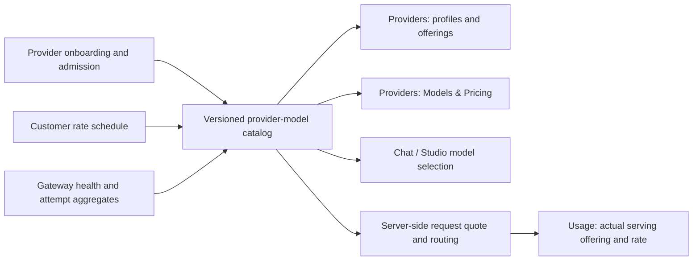

# SPEC_PROVIDERS — provider admission, catalog, routing and pricing display

**Status:** Canonical specification, 16 November 2026. Merges the former provider launch minimum, multi-provider routing design, B1 frontend data contract and B4 admission/routing handoff (all in [`archive/`](./archive/)) under decisions TD-26–35/37/39/41 and TD-48 ([DECISIONS.md](./DECISIONS.md)). Request authorization and settlement are owned by [SPEC_BILLING](./SPEC_BILLING.md). Auto model selection is a post-launch pilot ([reference](./reference/AUTO_MODEL_ROUTING_DESIGN.md)).

**Release:** Foundation (build-order steps 1 and 3). Roles: customer → Maxshot Gateway → provider. OpenRouter is one provider; Maxshot exposes no additional aggregator role.

## 1. Admission

A provider is **launch-ready** when Maxshot can identify it, configure at least one verified model offering, execute and meter a real request through the existing Gateway, charge the customer once, account for provider cost, and disable the offering when it fails. A self-service portal, continuous benchmark platform, ranking engine and provider-token features are not part of this gate. A small scripted admission test **is** required for each offering.

An **offering** is one approved provider endpoint/variant serving one verified model version with its own capabilities, policies, limits, customer rate card and internal provider cost card. Approval belongs to the offering; a provider's other models do not inherit it. One admitted, available route is enough to publish a customer model (TD-28). Two offerings share a customer model ID only after Maxshot verifies the same model version and required capabilities (TD-27). If a model's only route becomes unavailable, remove it from new-request pickers and reject new API use; keep history readable (TD-41).

### 1.1 Six launch gates

| Gate | Minimum evidence | Owner |
| --- | --- | --- |
| 1. Commercial and data permission | Provider identity/contact, accepted terms or contract, right to route/resell the selected model, allowed regions and retention policy, payout terms | Business/operations |
| 2. Working connection | Endpoint, authentication stored as a secret, rate limits, timeout, and a successful authenticated call through the Gateway's existing provider interface | Engineering |
| 3. Verified offering | Stable provider ID and endpoint variant, native model ID/version and material variant (such as quantization or service tier), customer-facing model mapping, supported modality/controls, context or output limits, provider price and unit, effective price version | Product + engineering |
| 4. Scripted admission test | Repeatable test of model identity, advertised controls, valid output, usage and price, invalid request, rate limit, timeout, and streaming or job completion when offered; unsupported parameters are rejected rather than silently ignored. Review output quality manually. | Engineering + product |
| 5. Metering and settlement | Provider request ID, billable usage units, provider cost under the agreed rate card, one customer charge under the accepted customer price; append-only attempt/cost/correction/dispute records and manual invoice reconciliation | Finance + engineering |
| 6. Safe operation | Offering can be enabled, disabled, and removed from eligible routes without code deployment; failed/unhealthy offerings stop receiving new traffic; support has a provider contact and request trace | Operations + engineering |

These gates apply **per offering**. One provider may launch with one text model while its media offerings remain unverified. Discovery of additional models does not publish them automatically. A model name alone does not establish version or capability equivalence. A declared provider readiness flag may pause an offering, but it cannot bypass Maxshot approval.

One verified route is enough to publish a customer-facing model at launch. A second qualified route is preferred for resilience, not required. If its sole route fails, mark the model unavailable rather than replacing it with another model without authorization.

### 1.2 Smallest plug-in contract

Use the Gateway's existing provider adapter if it can represent the offering. Add a provider-specific adapter only for protocol differences. No new public customer API or provider self-service API is required.

```text
Configuration: provider_id, endpoint/secret reference, native_model_id,
  verified_model_version, customer_model_id, capabilities, region/retention,
  provider_rate_card_version, limits, enabled/disabled status.

Input to provider: request_id, attempt_id, native_model_id, supported
  parameters, timeout, provider cost ceiling.

Result from provider: native_request_id, completed/failed status, normalized
  output or error class, billable usage with units, timing.
```

For streaming, the adapter must identify a terminal success or failure and return final usage. For asynchronous image/video, it must identify the job and terminal status; this is required **only if that offering is launched**. If final usage is delayed or missing, keep the charge pending reconciliation rather than inventing billable units. Routine telemetry stores IDs and metrics, not prompt or output content.

An asynchronous media offering is eligible for admission only when its declared maximum job time plus the configured grace window is **less than 24 hours**, leaving time to resolve an uncertain job before the fixed hold auto-release ([SPEC_BILLING §5](./SPEC_BILLING.md#5-media-job-lifecycle)).

When an upstream such as OpenRouter itself routes among underlying endpoints, pin its approved endpoint and disable upstream fallback at launch so Maxshot can enforce the one-backup limit across the full request. Require supported parameters, data policy and provider-cost ceiling; disable upstream cross-model fallback. Capture the actual serving endpoint where the upstream reports it. If an upstream cannot enforce these constraints, do not use it as an automatically selected backup. This prevents a second router from silently undoing Maxshot's offering approval.

### 1.3 Minimum onboarding proof (per offering)

Keep one small, repeatable evidence packet **per offering**. A provider may launch with one admitted offering; its other models do not inherit approval.

| Packet item | Evidence to retain |
| --- | --- |
| Permission | Reference to approved right to serve/resell this exact model, allowed region and data policy, provider contact, and payout terms. |
| Offering record | Stable provider, customer model, and offering IDs; exact native version/variant; verified controls and limits; effective customer and provider rate-card versions. |
| Live call | One authenticated Gateway request with valid output and verified billable usage; keep request and attempt IDs, not routine prompt/output content. |
| Billing trace | The same request links the provider attempt, provider cost, funding reservation, and exactly one final customer charge. |
| Failure and disable | Scripted unsupported-parameter rejection, rate-limit and timeout handling, duplicate settlement/callback safety, and manual disable; no new request reaches the disabled offering. |

Review the scripted result and output quality manually, then enable a limited-volume or spend-capped cohort. If an upstream routes internally, retain proof that its approved endpoint is pinned and its own fallback is disabled. Reconcile the **first provider statement** against append-only attempt and cost records before payment; link corrections or disputes rather than editing history. The first invoice is a settlement checkpoint, not a prerequisite to the first controlled request.

**Platform proof, once for multi-provider routing:** Admit a second provider offering for the **same verified model/version and required capabilities** through the same packet. Show lowest-qualified-cost selection, preservation of an explicit provider pin, and at most one pre-output fallback after an allowed failure. The backup must remain within the original customer and provider cost ceilings, keep the same Maxshot request ID, and yield one customer charge. This proves the common route and billing flow; a second offering is **not** required for every published model.

An upstream router counts as one approved offering only when its actual endpoint is pinned, its own provider/cross-model fallback is disabled, and its controls, data policy, cost ceiling and serving-endpoint trace can be verified. Otherwise it is ineligible for automatic routing or backup. The first provider statement is reconciled against append-only attempt/cost/correction records **before payout**, not before the first controlled request (TD-30).

## 2. Catalog data contract (formerly B1)

Owner note: the Gateway owns provider identity, offering admission, availability, customer price and observed performance; the frontend renders one versioned read snapshot. The example JSON and field names are a suggested frontend mapping, not a mandated internal schema. The prototype catalog (`frontend/src/data/providerCatalog.js`) is illustrative only.

### 2.1 Scope and ownership



The Gateway owns provider identity, offering admission, availability, customer price, and observed performance. The frontend renders a **single versioned read snapshot** of those records. The server remains authoritative for request eligibility, the accepted quote, allowed fallback, and final charge. A catalog page price is informational; it does not authorize a request.

The public launch catalog contains only **admitted offerings**. The prototype also displays explicitly labeled admission-pending sample rows to demonstrate the state; those rows must not become routable or appear as active production prices. Provider costs, credentials, endpoints, contacts, payout terms, raw attempts, and invoice details stay internal.

### 2.2 Minimum read entities

| Entity | Required frontend fields | Source / rule |
| --- | --- | --- |
| Provider | `providerId` (stable), display name, route type (`direct` or `aggregator`), approved public summary, optional brand mark | Onboarding gate 1; do not publish private contract or contact data. Derive offering count and model focus from the catalog rather than maintaining separate counts. |
| Customer model | `modelId` (stable customer-facing ID), approved `displayName` and description, exact verified version, modality, `catalogId`, list of offering IDs, and Basic/Premium/Free eligibility label when applicable | One current Credit catalog assignment per model (TD-23). The Gateway owns the display name and model label; Basic/Premium labels also govern eligible API text funding (TD-47). The frontend must not infer allowance coverage from a provider name or model ID. Merge provider aliases only after version and required capability equivalence are verified (TD-27). Provider discovery may retain an admitted model that is temporarily unavailable; Chat/Studio new-request lists omit it (TD-41). |
| Provider-model offering | `offeringId` (stable, never reused), `providerId`, `modelId`, public variant/tier label, admission status, availability, current-viewer policy eligibility, verified capabilities, limits, region/data policy, current customer rate-card version, optional observed performance | Identity, capability, and policy attach to the **offering**, not the provider or model alone. One provider may have admitted text while media remains pending. A viewer-scoped picker treats missing policy eligibility as ineligible; the server remains authoritative at dispatch. |
| Customer rate card | `rateCardVersion`, currency, effective time, billable components with amount and unit, and any applicable mode/resolution/condition | One complete customer schedule per offering (TD-34). Keep provider cost schedules internal. Do not synthesize a model price from rates of different providers. |
| Performance summary | Measurement window, dispatched attempt count, delivered-success percentage when supportable, latency metric (`first_token` or `completion`), latency sample count, p50/p95 in milliseconds when supportable | Computed from Maxshot attempts, per offering. The backend returns null percentages/percentiles when the sample is insufficient; the UI shows the count and **Insufficient data**. Do not infer performance from admission tests or provider claims. |

`admissionStatus` is `pending`, `passed`, or `failed`. `availability` is `available` or `unavailable` with a short public reason such as `paused` or `unhealthy`; it is independent of admission. An offering can be admitted yet temporarily unavailable. The viewer-scoped `policyEligible` example field is true only when the Gateway permits that viewer to request the offering under current region/data rules; absence is ineligible for a picker. Only a passed, enabled, healthy, policy-eligible offering may enter a live route. Public listing of failed/pending offerings is not required at launch.

Use decimal **strings** for money, explicit billing units (for example `per_1m_tokens`, `per_image`, `per_megapixel`, `per_second`), and UTC timestamps. Zero is a real free component; `null` or omission means unavailable or not applicable. A “from” display is derived from a complete conditional schedule and must never be treated as the final request quote.

### 2.3 Read snapshot shape

The Gateway may deliver this through its existing catalog service or equivalent internal frontend read endpoint. The exact URL and storage design are implementation choices. The fields and joins below are the contract:

```json
{
  "catalogVersion": "catalog-42",
  "generatedAt": "2026-11-14T00:00:00Z",
  "providers": [
    {
      "providerId": "provider_example",
      "name": "Example Provider",
      "routeType": "direct",
      "summary": "Approved public provider description."
    }
  ],
  "models": [
    {
      "modelId": "example/model-v1",
      "displayName": "Example Model v1",
      "chatEligibilityIndex": "P",
      "verifiedVersion": "v1",
      "modality": "text",
      "description": "Approved public model description.",
      "catalogId": "catalog_text",
      "offeringIds": ["offering_example_v1"]
    }
  ],
  "offerings": [
    {
      "offeringId": "offering_example_v1",
      "providerId": "provider_example",
      "modelId": "example/model-v1",
      "variantLabel": "Standard",
      "admissionStatus": "passed",
      "availability": "available",
      "policyEligible": true,
      "capabilities": ["streaming", "tools", "json"],
      "limits": { "contextTokens": 128000, "maxOutputTokens": 8192 },
      "dataPolicy": { "regions": ["US"], "retentionLabel": "Reviewed policy label" },
      "customerRateCard": {
        "rateCardVersion": "retail-7",
        "currency": "USD",
        "effectiveAt": "2026-11-14T00:00:00Z",
        "components": [
          { "kind": "input_tokens", "amount": "1.25", "unit": "per_1m_tokens" },
          { "kind": "output_tokens", "amount": "5.00", "unit": "per_1m_tokens" }
        ]
      },
      "performance": {
        "windowStart": "2026-11-07T00:00:00Z",
        "windowEnd": "2026-11-14T00:00:00Z",
        "dispatchedAttempts": 280,
        "deliveredSuccessPercent": "99.3",
        "latencyMetric": "first_token",
        "latencySamples": 278,
        "p50Ms": 410,
        "p95Ms": 920
      }
    }
  ]
}
```

This example defines shape, not an actual provider, verified model, rate, or performance result. Media offerings use the same identity and status fields, with relevant media capabilities, limits, and billable components. Conditional rate cards must expose their complete approved conditions, not just a minimum headline rate.

## 3. Routing policy

1. **Hard gates for every mode:** request modality and controls, exact model identity/version, account/plan/catalog eligibility, privacy and region policy, provider health/capacity, customer price and authorized charge ceiling, spending limit, and provider cost/risk ceiling. A failed gate cannot be offset by a score, token holding, or commercial payment.
2. **Explicit offering pin:** use that offering if it passes every gate; otherwise report it unavailable. Do not silently switch providers or models.
3. **Customer-selected model without provider pin:** choose the lowest quoted provider cost among qualified equivalent offerings for that model, using a stable offering ID to break exact ties. This is the launch default decided in [DECISIONS.md](./DECISIONS.md) (TD-26). Quality, latency and data policy are gates, not optional score tradeoffs.
4. **Post-launch Auto pilot in web text Chat:** after separate pilot approval, use [Auto Model Routing Design](./reference/AUTO_MODEL_ROUTING_DESIGN.md) to choose an offering from its evaluated pool. The base ranking considers task fitness, observed quality, reliability, latency and cost after every hard gate. Other surfaces do not inherit Auto.
5. **Dispatch and failover:** freeze the selected offering, its rate, the authorized customer charge ceiling, catalog and policy versions for the accepted request. For an unpinned request, the approved standing policy permits one pre-output backup offering for the same verified model/version under the original ceilings. Its customer rate may differ, but must fit the disclosed and authorized maximum; settle against the offering that serves the request. A pinned offering does not switch. Cross-model fallback is off at launch.

This resolves an ambiguity in the earlier draft: performance ranking applies to the approved Auto mode, while the ordinary chosen-model route remains lowest qualified provider cost. Any change to that default is a new product decision, not an implication of PT integration.

**Provider pin surfaces (TD-48):** Chat and Studio model pickers carry a provider selector (default **Auto**); API requests accept an optional `offeringId`. A pinned offering that fails any gate is rejected before dispatch; there is no automatic or opt-in fallback. This supersedes the earlier routing design's instruction not to add a provider selector.

### 3.1 Resilience policy for launch

[OpenRouter's routing overview](https://openrouter.ai/blog/insights/model-routing/) separates model selection, provider selection and the two kinds of fallback. Its [current traffic-routing documentation](https://openrouter.ai/docs/guides/providers/traffic-routing) also uses recent reliability, 429 capacity rejects, latency and effective price; it is more involved than the blog's inverse-square example. Maxshot should adopt the **separation and safeguards**, not copy that weighting algorithm or build a large ranking engine for launch.

1. **Same-model provider fallback:** the approved standing policy allows at most one backup offering after a pre-output 429, 5xx, connection failure or timeout. The backup must be a verified equivalent model/variant, support every required parameter and data rule, and fit the original customer charge and aggregate provider-cost ceilings. An explicit provider pin disables automatic fallback. Disclose the serving provider and any fallback in the request record.
2. **Cross-model fallback:** keep disabled by default. For an optional future Auto setting, present an ordered, approved backup-model list and the maximum charge before submission. Recheck catalog and plan eligibility on each backup, report the actual serving model, and never use a moderation or context error to switch to a different model without that prior authorization. [OpenRouter's model-fallback feature](https://openrouter.ai/docs/guides/routing/model-fallbacks) is a useful pattern, but its default trigger set is broader than Maxshot should accept.
3. **No duplicate output or charge:** do not retry after customer-visible stream output begins. Do not resubmit an asynchronous media job whose acceptance status is unknown. Record each attempt and settle the customer once; track provider charges even when a failed or cancelled attempt costs Maxshot money.
4. **Light health backoff:** temporarily remove an offering from new routing after a short burst of provider faults or 429s, while preserving manual disable. Track provider faults, capacity rejects, user-input errors and customer cancellations separately. The launch policy needs an operations-owned threshold, not a learned traffic-share engine.

For the launch lowest-cost decision, compare a versioned **request-specific provider cost estimate** using the rate card and relevant usage/caching terms where known, not just one headline token price. Show the selected customer's rate and authorized charge ceiling before Chat or Studio submission; authorize API requests internally before dispatch under TD-37. A permitted backup may have a different customer rate within that ceiling. Unknown cost or unsupported controls makes an offering ineligible.

Healthy new offerings may receive a small, spend-capped exploration allocation to collect performance data. Exploration remains subject to every hard gate and user-facing cost rule. Disable a failing offering promptly; do not promote an untested provider because it lacks negative history.

### 3.2 Routing and accounting rules

1. An offering is eligible only if it is enabled, verified for the requested model/version and controls, permitted by the account and data policy, healthy, and within the authorized customer charge and provider cost ceilings.
2. For a customer-selected model, use the existing decided default: lowest quoted provider cost among qualified offerings. An explicitly pinned offering stays pinned. Score-based Auto selection follows its separate product design.
3. An unpinned request may try at most one verified equivalent provider offering for the same model/version after a 429, 5xx, connection failure or timeout before customer-visible output. A pinned offering never falls back automatically. Each attempt uses a new attempt ID under the same Maxshot request ID; the backup must preserve required controls and data policy and fit the original customer charge and aggregate provider-cost ceilings. If it cannot, return an error. Cross-model fallback is off at launch.
4. The customer is charged **once** from the accepted customer price and verified usage. Provider cost and customer charge remain separate records. Duplicate callbacks, retries, and invoice corrections cannot create another customer deduction.
5. A provider price, model version, capability, or data-policy change makes the affected offering ineligible until its record is reviewed. Other verified offerings can continue.

## 4. Pricing and customer display

| UI surface | Read fields and behavior |
| --- | --- |
| Provider profile | Join `providerId` to offerings and models. Show approved summary, route type, and a derived model/approved-offering count. List each admitted model; opening one selects its exact `modelId` in Models & Pricing. |
| Offering comparison | Group by exact `modelId` and show each provider's `variantLabel`, admission, current availability, verified capabilities/limits, and reviewed region/retention. Show delivered success and p50/p95 only when returned; otherwise show **Insufficient data** with window and counts. Never show provider-level aggregate performance as if it applied to all models. |
| Models & Pricing | Group by exact model/version. Open one model to compare **complete customer rate cards by offering**; include currency, units, conditions, and rate version/effective time. Mark unavailable offerings without implying that the displayed rate makes them selectable. Do not show internal provider cost. |
| Chat / Studio model picker | Gateway supplies only currently usable models with admitted, available, policy-eligible routes. Omit unavailable models rather than showing disabled choices. Maintain at least five distinct usable models per enabled text, image, and video catalog (TD-41); two offerings of one model do not count as two models. Historical records may still name a removed model, but new requests must choose from the current list. Catalog eligibility remains an independent account/program check. |
| Request quote and Usage | Chat and Studio show the server-selected `offeringId`, rate-card version, estimate, hard maximum and maximum funding split before submission. API uses one call: the Gateway calculates and reserves that full maximum before dispatch, enforces the optional caller ceiling and account/API-key limits, and rejects unaffordable requests without provider execution. The final customer charge may exceed the estimate but never the accepted maximum; provider overrun is recorded separately. Usage records selected and actual serving `offeringId`, actual rate version, verified units, funding sources, final charge, released hold, and whether fallback occurred. The frontend never recomputes a binding quote from catalog display rates. |

For a catalog refresh, use `catalogVersion` to replace the displayed snapshot coherently. A model, rate, capability, or policy change makes an offering ineligible until reviewed; an in-flight request retains its accepted catalog and price versions. The UI must not retain a stale rate as a current quote after a version change. Public discovery may show more offerings than a viewer may request, but the viewer-scoped picker list must use the same version and require at least one passed, available, policy-eligible route per model.

### 4.2 Customer-facing offering evidence

The Providers page owns provider profiles, approved model/version and capabilities, current enabled/available state, and admission-test status. Once enough Maxshot-observed attempts exist, show delivered success and p50/p95 latency per offering with the measurement window and sample count, using first-token latency for streaming text and completion latency for other modes. If the sample is too small, show **Insufficient data** and the count instead of a percentile or ranking. Label prototype values simulated; do not present provider claims or scripted admission results as observed production performance. Providers → Models & Pricing compares provider-specific customer rates for the selected model without duplicating performance details. Metering completeness, provider costs, invoice reconciliation, 429 counts, and attempt traces remain in operations reporting.

**External design reference:** OpenRouter separates model choice from provider choice and filters providers by required parameters, data policy and price ceiling. Its provider integration also records endpoint capabilities, prices, capacity and readiness. Maxshot adopts those checks, while keeping manual approval of each offering. See [routing overview](https://openrouter.ai/blog/insights/model-routing/), [provider-selection controls](https://openrouter.ai/docs/guides/routing/provider-selection), and [provider integration](https://openrouter.ai/docs/guides/providers/integration).

Operations measures delivered success, p50/p95 latency, metering completeness and cost reconciliation **per offering** under [§5](#5-measurement). Track 429 separately and exclude customer cancellations/user-input errors from delivered-success denominator. The Providers profile shows Maxshot-observed success and latency with window and sample count only when the sample is sufficient; otherwise it says **Insufficient data** with the count. Models & Pricing compares complete customer rate cards by provider, without presenting internal costs or a blended model price.

Before live enablement, operations supplies each offering's actual provider/model mapping, rates, region/retention, service limits, health and sample thresholds, provider-cost ceiling, contact, and payout terms. These values are configuration and evidence inputs, not missing product behavior decisions. Provider Tokens do not affect launch routing.

## 5. Measurement

Measure each **provider-model offering**, not just the provider. The launch dashboard or operations report needs only these four measures:

| Measure | Calculation | Launch use |
| --- | --- | --- |
| Delivered success | Valid completed attempts / dispatched attempts excluding customer cancellations and user-input errors; count provider setup errors, 5xx, malformed output, mid-stream failure and timeouts as failures; show 429 capacity rejects separately | Disable or investigate failing routes |
| Latency | p50 and p95 dispatch-to-first-token for streaming text, or dispatch-to-completion for other modes; show sample count | Compare against the offering's agreed limit |
| Metering completeness | Terminal attempts with verified billable units / terminal attempts | Block final settlement when usage is missing |
| Cost reconciliation | Sum of per-attempt provider cost plus recorded corrections versus provider invoice | Explain every payout difference before payment |

Keep raw attempt IDs, status/error class, native request ID, time, usage units, rate-card version, calculated provider cost, and customer charge so these measures can be recomputed. If traffic is too small for a meaningful percentile, show the sample count and use a simple scheduled test call as a health signal. Numeric latency and success floors are set per offering before it is enabled; a universal threshold across text, image, and video would be misleading.

## 6. Provider Tokens boundary

The first qualified Provider Token release has **no effect on compute routing** (TD-33). Link an approved `pt_instrument_id` to a qualified `provider_id` in a separate PT registry with its issuer, rights documents, allowed holders/transfers, chain, contract and any PT/MAX pool and fee-collector references. Route eligibility comes only from delivery evidence; PT issuance, trading volume, price and TVL do not increase eligibility, customer price or provider payout. If a PT/MAX market is later approved, its fee ledger allocates only collectible distributable net fees under the proposed 50% LP / 30% qualified staked MAX / 20% AIT buyback-reserve direction, separate from the inference and provider payable ledgers; market-bought AIT is inventory and is not burned without debt-safe settlement. Any PT-linked routing preference is a later, separate decision limited to an approved Auto cohort with a shadow phase, caps and disclosure; it never applies to an explicit pin or the ordinary lowest-cost route. Full reasoning in [archive/MULTI_PROVIDER_ROUTING_DESIGN.md](./archive/MULTI_PROVIDER_ROUTING_DESIGN.md).

## 7. Acceptance

### 7.1 Catalog transitions (formerly B1)

| Gateway catalog change | Providers and pricing | Chat/Studio new requests and API | History |
| --- | --- | --- | --- |
| Admit a new offering for an existing verified model | Show it under its provider and the exact `modelId`, with its own customer rate card | Add it as an eligible route only after availability and viewer policy pass; model appears once in its modality picker | Existing records unchanged |
| Admit a new verified model with a complete display name, catalog assignment and offering | Show the new model and rate card from the same `catalogVersion` | Add it to the matching picker and API list without a separate frontend model-name registry | Existing records unchanged |
| Pause, fail, or make one offering policy-ineligible | Show the offering's current status; retain its rate as informational | Remove that route immediately; retain the model only if another eligible offering exists | Existing records remain readable |
| Remove the last eligible offering for a model | Keep the model discoverable only where product listing rules permit, marked unavailable | Omit the model from new-request pickers and reject its API selection before provider dispatch | Old conversation/creation names and Usage remain readable |
| Publish a new rate or catalog version | Show the new version and effective time together | Refresh the picker coherently; server re-quotes before a new request and rejects a stale accepted maximum | In-flight requests keep accepted versions |

**B1 verification:** Engineering supplies one versioned Gateway snapshot and demonstrates these transitions using the same model and offering IDs across Providers, Chat, Studio, and API. Compare each new-request list to the server's authoritative eligibility response. Do not count two offerings of one model as two usable models; maintain at least five distinct usable models per enabled catalog. The prototype exercises status-derived membership with simulated data, but this checkout cannot verify live Gateway output or account policy decisions. Quote, fallback, and settlement acceptance continue under SPEC_BILLING §7.

### 7.2 Admission and shared routing (formerly B4)

Use **two admitted offerings for one verified equivalent model** to prove the common route once. A second route is not required for every published model. Capture the accepted catalog, policy and rate versions and the selected and serving offering for each case. The internal identifier/schema is an engineering choice; records must still join attempts to the single customer charge.

| Scenario | Required result |
| --- | --- |
| Unpinned selected model; both offerings qualified | Select the lowest request-specific quoted provider cost; break an exact tie by stable offering ID. Model/version, controls, account eligibility, region/data policy, health and both cost ceilings are hard gates. |
| Customer pins one offering | Use that offering if qualified; otherwise return unavailable. No automatic provider or model switch. |
| Unpinned first attempt fails with 429, 5xx, connection failure or timeout **before** visible output | Try at most one other verified equivalent offering if it preserves controls and policy and fits the original authorized customer maximum and aggregate provider-cost ceiling. Record both attempts and the actual serving offering/rate; settle the customer once. If no backup qualifies, return an error. |
| Failure after visible stream output, or uncertain acceptance of a media job | Do not retry or resubmit automatically. Preserve the partial/uncertain attempt and reconcile usage and provider cost under SPEC_BILLING §5. |
| Unsupported parameter, changed model version, changed rate/policy, disabled or unhealthy offering | Reject or remove the affected offering from new routing until reapproved. Do not silently strip controls or substitute another model. |
| Duplicate callback, provider invoice correction or dispute | No second customer debit. Preserve append-only provider attempt, cost, correction and dispute records; reconcile the first statement before payout. |

Chat and Studio show the selected offering's server estimate and hard authorized maximum before submission. The single-call API authorizes internally before dispatch. The maximum includes any permitted backup's customer rate; the final charge uses the **serving** offering's published rate and verified units and cannot exceed the accepted maximum. Usage exposes selected/serving offerings, rate version, fallback, verified units, funding and one final charge under B2. Provider cost and invoice detail remain internal.

Chat and Studio show the selected offering's server estimate and hard authorized maximum before submission; the single-call API authorizes internally (TD-37). The maximum includes any permitted backup's customer rate; the final charge uses the **serving** offering's published rate and verified units and cannot exceed the accepted maximum (TD-39). Usage exposes selected/serving offerings, rate version, fallback, verified units, funding and one final charge. Provider cost and invoice detail remain internal.

### 7.3 Rollout

1. Normalize OpenRouter and one additional provider into the same offering schema; pilot a few text offerings using the chosen-model lowest-qualified-cost rule.
2. After the chosen-model launch, approve Auto's evaluation set, cost ceiling, pass thresholds and pilot cohort; run it in shadow mode, then a limited opt-in web text-Chat cohort.
3. Expand providers and modalities only after capability, job-state, metering and settlement tests pass. If PT is later launched, connect its registry and fee accounting first.

## 8. Backend output checklist

The **product rules** above are decided. The following are implementation outputs to verify in the live Gateway, not new strategy decisions:

1. Map the existing configured model/provider records to stable `providerId`, `modelId`, and `offeringId`, including native ID/version and equivalence evidence kept internally.
2. Expose one versioned frontend read snapshot containing provider public fields, model membership, per-offering admission/availability, vetted capabilities/limits/policy, and full customer rate cards. Confirm the existing catalog endpoint can serve it or add the smallest internal read surface.
3. Compute per-offering seven-day (or published configured window) delivered success and latency summaries from Gateway attempts. Return sample counts and null unsupported metrics. Confirm operations' per-offering minimum sample policy before numeric metrics are shown.
4. Use [SPEC_BILLING](./SPEC_BILLING.md) for the accepted quote, single-call API, maximum hold, serving trace, settlement and reversal proof. Expose API route/rate metadata in the response where compatible and always in Usage. Keep internal provider cost and attempt ledger separate.
5. Replace the `providerSnapshot` fixture in `frontend/src/data/providerCatalog.js` only after those read outputs exist; keep the profile, comparison, and pricing screens on the same snapshot and presentation mapping.

## 9. Later work and inputs

**After launch evidence:** continuous benchmark suites, large-sample quality scoring, synthetic monitoring fleets, automated provider payouts, provider self-service application and settlement portals, public rankings, commercial routing boosts and Provider Tokens. Stable IDs and versioned offering/price records preserve room for them.

**Live-enable inputs (per offering, from operations):** actual provider/model mapping, rate cards, permitted region/retention, numeric service limits, health and sample thresholds, provider-cost ceiling, contact and payout terms. Placeholders for tests in [LAUNCH_CONFIG_V0](./LAUNCH_CONFIG_V0.md).

**Open parameters:** first additional provider and pilot offerings; Auto evaluation dataset, weights, windows and exploration cap; operations-owned health-backoff threshold and per-offering aggregate provider-cost ceiling; whether PT should ever influence Auto routing.

**Prototype limit:** the prototype demonstrates provider profiles, simulated admission/availability, equivalent offerings with different customer prices, Models & Pricing and a sample selected-versus-serving fallback in Usage from one simulated snapshot (`frontend/src/data/providerCatalog.js`). It does not prove authenticated provider calls, upstream endpoint pinning, live health backoff, immutable attempt/cost records or invoice reconciliation. Chat and Studio carry the TD-48 provider selector in the prototype.
